# Agentic Identity and Accountability — Reference Architecture

| | |
|---|---|
| **Reference architecture set** | Agentic Enterprise ([the set](README.md)) |
| **Also known as** | Agentic IAM |
| **Compliance scope** | EU Artificial Intelligence Act · General Data Protection Regulation · enterprise centralized logging |
| **Status** | Version 1.1 — October 2026 ([revision history](#revision-history)) |
| **Audience** | Solution architects, security and identity architects, platform engineers, data protection officers, AI governance and audit functions |

---

## Contents

1. [Introduction](#1-introduction)
2. [Principles and invariants](#2-principles-and-invariants)
3. [Overall architecture](#3-overall-architecture)
4. [Identity](#4-identity)
5. [Delegation and attenuation of authority](#5-delegation-and-attenuation-of-authority)
6. [Agent registry and lifecycle](#6-agent-registry-and-lifecycle)
7. [Authorization and policy enforcement](#7-authorization-and-policy-enforcement)
8. [Human oversight](#8-human-oversight)
9. [Transparency towards people](#9-transparency-towards-people)
10. [Personal data protection](#10-personal-data-protection)
11. [Logging and telemetry](#11-logging-and-telemetry)
12. [Audit ledger and evidence](#12-audit-ledger-and-evidence)
13. [Provenance of agents, models and data](#13-provenance-of-agents-models-and-data)
14. [Tools, external systems and data egress](#14-tools-external-systems-and-data-egress)
15. [Security of the agent runtime](#15-security-of-the-agent-runtime)
16. [Risk classification and governance](#16-risk-classification-and-governance)
17. [Operations: retention, monitoring and incidents](#17-operations-retention-monitoring-and-incidents)
18. [Compliance traceability matrix](#18-compliance-traceability-matrix)
19. [Adding a target environment](#19-adding-a-target-environment)
- [Revision history](#revision-history)
- [Appendix A — Canonical event schema](#appendix-a--canonical-event-schema)
- [Appendix B — Delegation context schema](#appendix-b--delegation-context-schema)
- [Appendix C — Glossary](#appendix-c--glossary)
- [Appendix D — References](#appendix-d--references)

---

## 1. Introduction

### 1.1 Goal

Agentic applications let software components — *agents* built around language models — plan, call tools and take
actions with a degree of autonomy. They raise three questions that ordinary applications answer implicitly and agents
do not:

- **Who is responsible** for an action that no human performed directly?
- **Under what authority** did the agent act, and was that authority narrower than the person's who started it?
- **What evidence** shows, after the fact, what happened, why it was allowed, and whether a human could have stopped it?

This document defines a reference architecture that answers those questions **by construction**: the chain of
responsibility from a person to an agent's action is created, enforced and recorded by the platform, rather than
reconstructed from logs after something has gone wrong.

### 1.2 Scope

The architecture covers applications in which one or more agents act for people or for an organisation, and it is
designed to satisfy three bodies of requirements together:

| Body | What it asks of this architecture |
|---|---|
| **EU AI Act** ([Regulation (EU) 2024/1689][aia], as amended by [Regulation (EU) 2026/1744][omnibus]) | Transparency to people interacting with AI ([Art. 50][aia-50]); for high-risk systems, record-keeping ([Art. 12][aia-12]), information to deployers ([Art. 13][aia-13]), human oversight ([Art. 14][aia-14]), accuracy, robustness and cybersecurity ([Art. 15][aia-15]), deployer obligations including log retention ([Art. 26][aia-26]), post-market monitoring and incident reporting ([Art. 72–73][aia-72]); AI literacy ([Art. 4][aia-4]). |
| **GDPR** ([Regulation (EU) 2016/679][gdpr]) | Principles ([Art. 5][gdpr-5]), lawful basis ([Art. 6][gdpr-6], [9][gdpr-9]), information and rights ([Art. 12–22][gdpr-12], in particular [Art. 22][gdpr-22] on automated decisions), data protection by design ([Art. 25][gdpr-25]), records of processing ([Art. 30][gdpr-30]), security ([Art. 32][gdpr-32]), breach notification ([Art. 33–34][gdpr-33]), impact assessment ([Art. 35][gdpr-35]), transfers ([Chapter V][gdpr-cpt-V]). |
| **An enterprise centralized logging standard** of the kind common in regulated organisations | Structured JSON logs with a fixed schema; OpenTelemetry instrumentation and W3C Trace Context; export only by OTLP to a collector gateway; no direct integration with a log vendor from application code; no personal data, secrets or tokens in logs; a designated, append-only platform of record; cost-aware volumes and level discipline; fail-open, non-blocking logging. |

Out of scope: model training and fine-tuning pipelines, the internal design of language models, and sector-specific
regulation beyond the three bodies above (it can be layered on the same mechanisms).

Sector rules interact with the AI Act and must be checked by any sector profile. For example, for financial
institutions the AI Act lets the deployer's monitoring duty (Art. 26(5)) and log keeping (Art. 26(6)) be met through
internal governance and documentation required by financial services law; creditworthiness assessment and credit
scoring of natural persons are high-risk (Annex III, point 5(b)); and the Digital Operational Resilience Act
([Regulation (EU) 2022/2554][dora]) adds ICT third-party risk management for model and cloud providers and its own
ICT-incident reporting next to AI Act Art. 73.

> **Legal note.** This document is an engineering reference, not legal advice. Whether a given system is *high-risk*
> under the AI Act depends on its intended purpose and must be determined by the organisation's legal and compliance
> functions (section 16). Dates of application below reflect Regulation (EU) 2026/1744 (the "Digital Omnibus on AI"),
> published in the Official Journal on 24 July 2026 and in force since 27 July 2026.

### 1.3 Place in the reference architecture set

This document is one of a set of reference architectures that together describe an enterprise built with agents. The
documents have no particular order; each owns a set of concerns and refers to the others where they meet (the set and
its proposed members: [README](README.md)).

This document owns **who acts, under whose authority, within what limits, under whose oversight, and with what
evidence**: identity of people, applications, agents and workloads; delegation; authorization and policy enforcement;
human oversight; transparency towards people; and the accountability record. It also treats logging, personal data
protection, security and risk governance — but only from the accountability viewpoint. Their full treatment belongs to
the sibling documents *Agent Observability and Evaluation*, *Privacy Engineering for AI*, *AI Security* and *AI
Governance and Lifecycle*; where those documents exist, they take precedence for everything outside accountability.

### 1.4 How to read this document

Every concern (sections 4 to 17) has the same two parts:

1. **Architecture** — the problem, the requirements it derives from, and a technology-agnostic design with its
   diagram. This part is normative for any implementation.
2. **Implementation on Azure** — one concrete realisation with Microsoft Azure and Microsoft Entra components. It is a
   *target environment profile*: other profiles (another cloud, on-premises, Kubernetes with open-source components)
   can be added beside it without changing the architecture part (section 19).

Requirement keywords **must**, **should** and **may** are used in their usual normative sense.

**Diagrams.** Structure is shown with the [C4 model](https://c4model.com): a *System Context* view and *Container* views
of the whole platform (section 3), a *Component* view drilling into the containers each concern involves (its
architecture part), and a *Deployment* view per target environment (its implementation part). Where one view would be
too dense to read, it is split into several of the same level. Behaviour is shown with C4's supplementary views:
sequence diagrams (dynamic views), state machines and data models. The notation, in every C4 view:

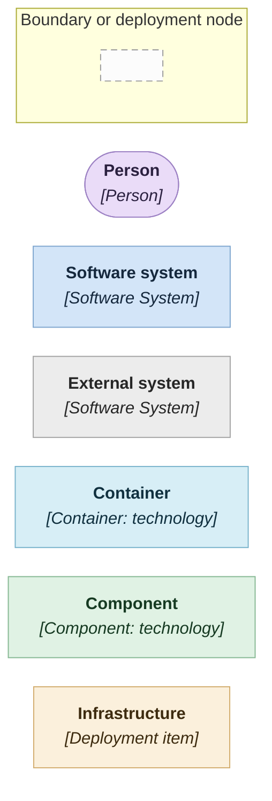

Element types are written in brackets in each box; a dashed frame is a system or container boundary, or a deployment
node. Solid arrows are requests or data flows, labelled with their purpose; dotted arrows are asynchronous or secondary
flows.

### 1.5 Terms used throughout

| Term | Meaning |
|---|---|
| **Principal** | A party that can be held to account: a person, or an organisation through its designated people. |
| **Agent** | A software component that pursues a goal by deciding which actions to take, usually with a language model. An agent is an *actor*, never a principal. |
| **Agent definition** | The versioned specification of an agent: purpose, instructions, model, tools, policies. |
| **Agent execution** | One run of an agent definition for a given request. Many executions share one definition and one agent identity. |
| **Delegation** | A record that a principal (or an agent acting under a delegation) grants a narrower authority to an agent, for a purpose and a time. |
| **Consequential action** | An action whose effect matters outside the agent and its initiator's own workspace: communicating with people, sending data out, changing records, publishing, spending, deciding about a person, deleting. Risk tiers R2–R4 (section 7); internal writes to the initiator's workspace (R1) are not consequential. |
| **PEP / PDP** | Policy Enforcement Point (where a request is stopped or let through) / Policy Decision Point (where the decision is computed). |

---

## 2. Principles and invariants

### 2.1 Principles

1. **An agent is never accountable for itself.** Every agent action traces back to a human principal or to an
   organisation's designated person.
2. **Authority flows down and only narrows.** What an agent may do is the intersection of its definition's permissions
   and the delegation it holds; a sub-agent never holds more than its parent.
3. **The agent proposes; the platform disposes.** Permission, risk and approval are decided outside the agent, by
   components the agent cannot influence. Instructions in a prompt are not a security boundary.
4. **Identity of the agent is not identity of the model.** An agent definition is the accountable software component;
   the model is one of its dependencies, recorded but not trusted as an identity.
5. **Evidence is produced at the moment of the action**, in a canonical form, and stored where it cannot be altered.
6. **Personal data is minimised everywhere the chain is recorded**: identifiers, not content; pseudonyms, not
   addresses; hashes, not payloads.
7. **People know when they deal with an AI system**, and AI-generated content is identifiable as such.
8. **Oversight is proportional to risk**: low-risk actions run autonomously under a supervising human; consequential
   actions escalate to a human by policy, not by the agent's judgement.
9. **Observability never breaks the business.** Telemetry is asynchronous and fail-open; the audit trail of
   consequential actions is the one exception and fails *closed* (section 12).

### 2.2 Invariants

The architecture is correct when these hold for every request:

| # | Invariant |
|---|---|
| I1 | No agent action exists without an attributable principal, an authenticated agent identity, a valid delegation, a policy decision and an execution record. |
| I2 | No consequential action executes unless the applicable human-oversight policy is satisfied. |
| I3 | The authority of an execution is a subset of the intersection of its agent definition's permitted actions and the delegation it holds; a delegation's authority is a subset of its delegator's. |
| I4 | No log, trace or audit record contains a person's direct identifier, a secret, a token, or the content people wrote or said. |
| I5 | Every record of the chain carries the same trace identifier, so the chain can be read end to end. |
| I6 | A person interacting with an agent is informed it is an AI system, unless that is obvious from the context. |

---

## 3. Overall architecture

### 3.1 Architecture

Agents sit in the middle of the platform; everything that grants, limits, checks and records their authority sits around
them and outside their control. The views below follow the C4 model (section 1.4): the system in its context, then its
containers; each concern of sections 4 to 17 drills down into the components of the containers it involves.

**C4 System Context view (level 1).**

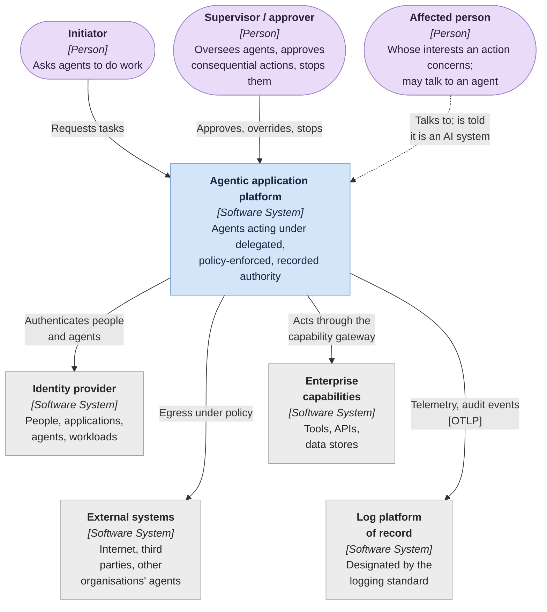

The platform drills down into containers in three views, one per concern group, so that each stays readable:

**C4 Container view (level 2) — execution and control.**

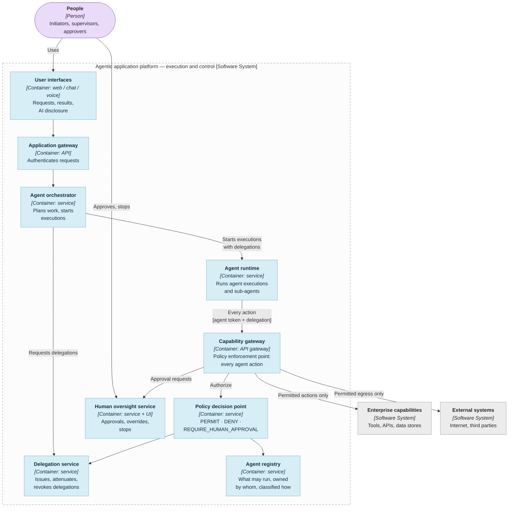

**C4 Container view (level 2) — observability and evidence.**

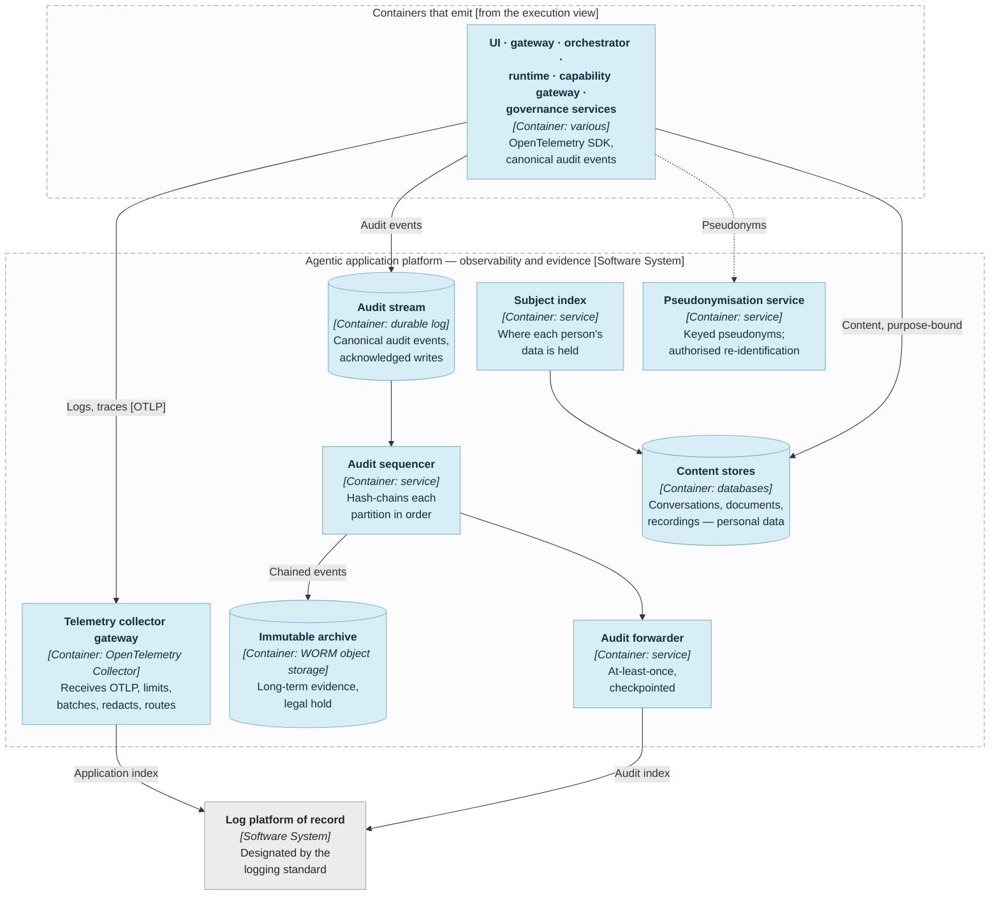

**C4 Container view (level 2) — governance and data protection.**

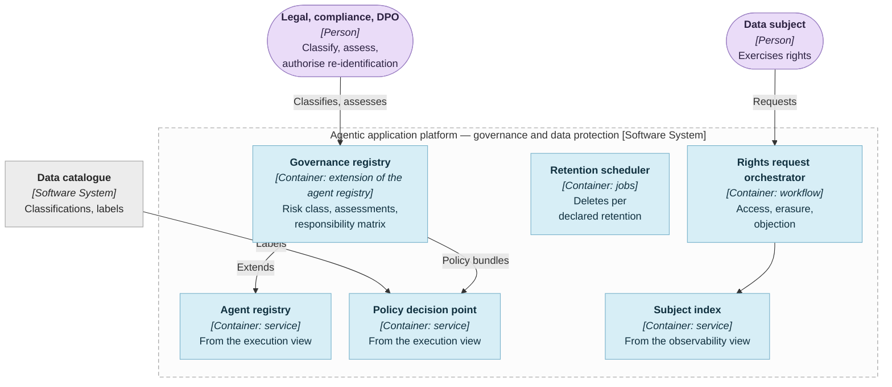

The responsibility chain runs from people down to resources; the evidence runs back up:

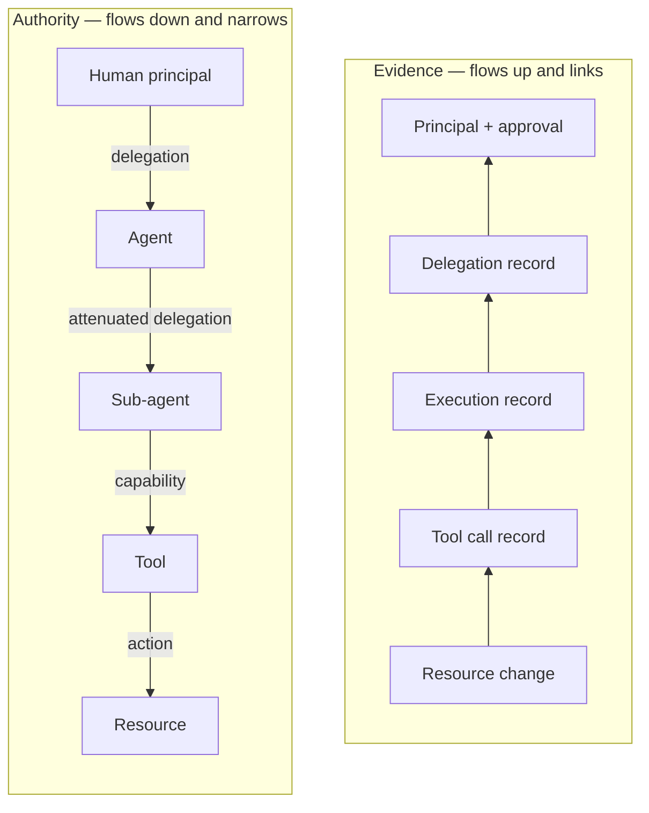

### 3.2 Implementation on Azure

**C4 Deployment view — the platform on Azure (placement; the flows of each concern are in its own deployment view).**

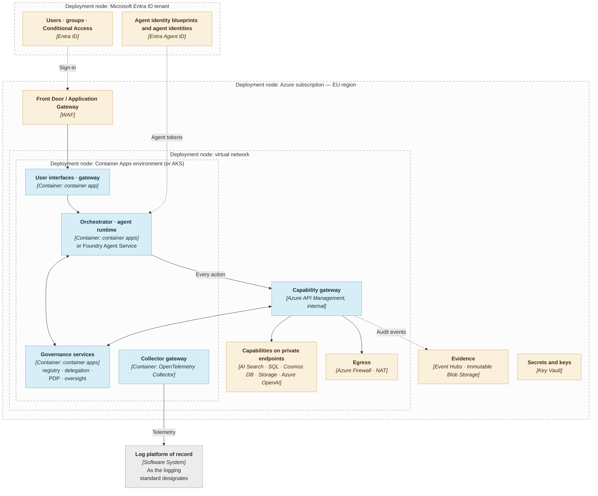

| Layer | Azure realisation |
|---|---|
| Identity | Microsoft Entra ID (people), Entra Agent ID (agents), managed identities (workloads), Conditional Access |
| Application | Container Apps or AKS behind Front Door / Application Gateway with WAF |
| Governance | Custom services on Container Apps, state in Azure SQL or Cosmos DB |
| Agent runtime | Container Apps / AKS, or Microsoft Foundry Agent Service where its agent identity and tracing fit |
| Enforcement | Azure API Management as the capability gateway, calling the PDP |
| Capabilities | Azure AI Search, Azure SQL, Cosmos DB, Storage, Azure OpenAI / Foundry, egress through Azure Firewall |
| Observability | OpenTelemetry SDKs → OpenTelemetry Collector gateway → log platform of record |
| Evidence | Event Hubs → Immutable Blob Storage (WORM), and the log platform of record |

---

## 4. Identity

### 4.1 Architecture

**Concern.** Accountability needs every acting party to be identifiable on its own terms. A single application
identity used by every agent erases the difference between "the application did it" and "agent X did it on behalf of
person Y".

**Requirements.** AI Act [Art. 12][aia-12] and [26][aia-26] (logs identifying the relevant parties); [Art. 14][aia-14] (identifiable human
overseers); GDPR [Art. 5(1)(c)][gdpr-5] and [25][gdpr-25] (identifiers that minimise exposure); the logging standard's prohibition of
direct identifiers in logs.

**Design.** Four kinds of identity, each with its own lifecycle:

| Identity | Represents | Authenticates with | Lifetime |
|---|---|---|---|
| **Human** | A person: a member of the workforce (initiator, supervisor, approver) or an external person (customer, citizen, partner) who uses or talks to an agent | The organisation's workforce identity provider, or a separate customer identity service for external people, with an assurance level | The person's employment / relationship |
| **Application** | A deployed application (name, version, environment) | Workload credentials (no stored secrets) | The deployment |
| **Agent** | One agent definition, or one agent role across many executions | Short-lived tokens obtained through a governed template | The agent's registry lifecycle |
| **Workload** | Infrastructure that runs things (containers, functions) | Platform-issued workload identity | The resource |

Rules:

- People are identified by an **immutable subject identifier** issued by the identity provider, never by e-mail
  address or display name, which can change or be reassigned.
- **Agent identity is per agent, not per execution**: ten thousand executions of one agent share one identity and are
  told apart by an execution identifier (section 6).
- Agents hold **no long-lived secrets**; they obtain short-lived tokens through a template that the organisation
  governs centrally (credentials, conditional policies, lifecycle).
- Every identity has a **human sponsor** accountable for its existence.
- **External people** are identified in their own directory and never receive roles of the workforce; an agent acting
  for an external person holds a delegation from that person, bounded by what the organisation offers to them. An
  unauthenticated person (for example a caller on a voice line) is an *affected person*, not a principal.

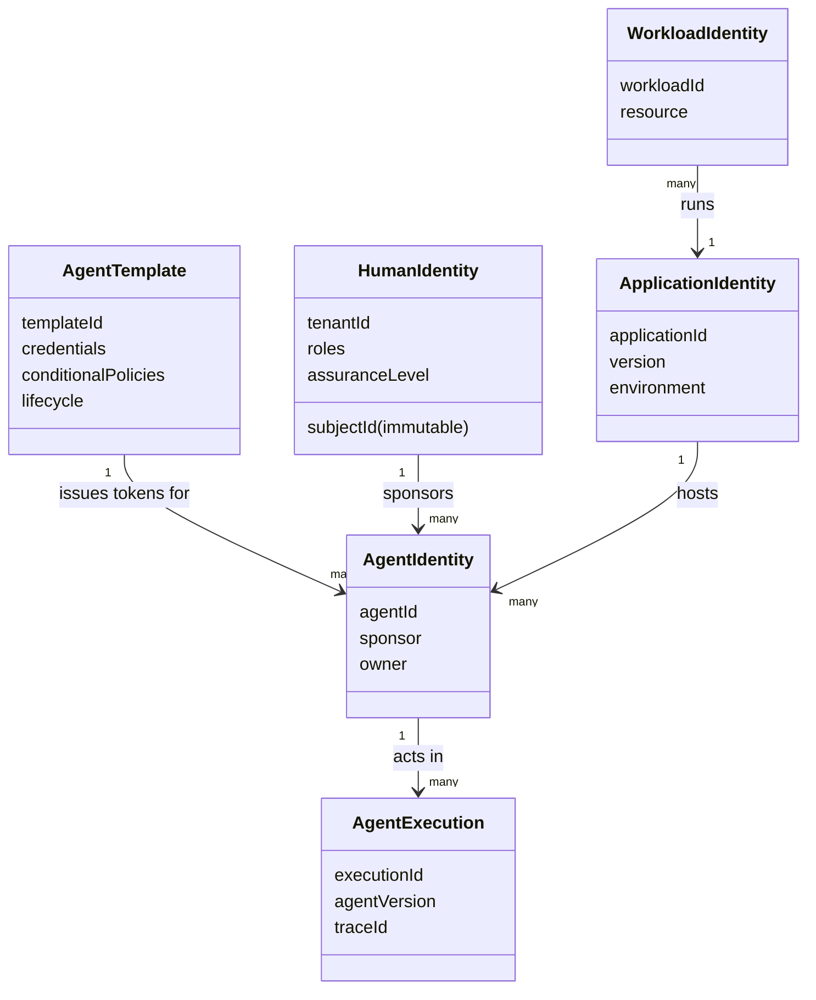

**C4 Component view — identity in the gateway, runtime and capability gateway.**

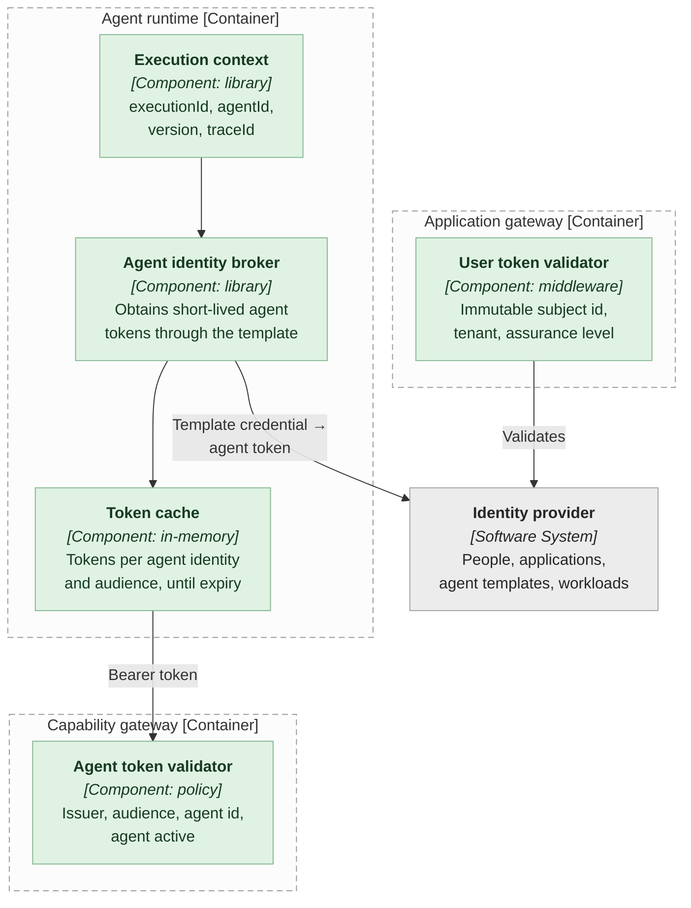

### 4.2 Implementation on Azure

| Identity | Azure component | Notes |
|---|---|---|
| Human | Microsoft Entra ID user | Use the `oid` (object id) and `tid` (tenant id) claims as the subject; Conditional Access and authentication strengths set the assurance level. |
| Human (external) | Microsoft Entra External ID (external tenant) | Customers and partners in a separate tenant from the workforce; same rule — `oid` and `tid` as the subject, never the e-mail address. |
| Application | App registration (for user sign-in) with a **managed identity** for its own calls | No client secrets in code; certificates or federated credentials when a secret is unavoidable. |
| Agent | **Microsoft Entra Agent ID**: an *agent identity blueprint* per agent family, *agent identities* created from it | The blueprint holds the credentials and acquires tokens for its agent identities; Conditional Access set on the blueprint applies to all of them. Give the blueprint a **federated credential trusting a managed identity**, so no secret or certificate is stored. Microsoft does not recommend traditional service principals or user accounts for AI agents. Agent identities have *owners* (technical) and *sponsors* (business accountability). In Microsoft Foundry, unpublished agents of a project share one agent identity; publishing gives an agent its own — required for separate audit trails. |
| Workload | Managed identity (system- or user-assigned) | For collectors, gateways, governance services. |

Licensing must be confirmed before design: Conditional Access and Identity Protection for agent identities, and
lifecycle workflows for sponsors, depend on additional Microsoft licences (Agent 365, Entra ID P2 and Governance at the
time of writing).

**C4 Deployment view — identities on Azure.**

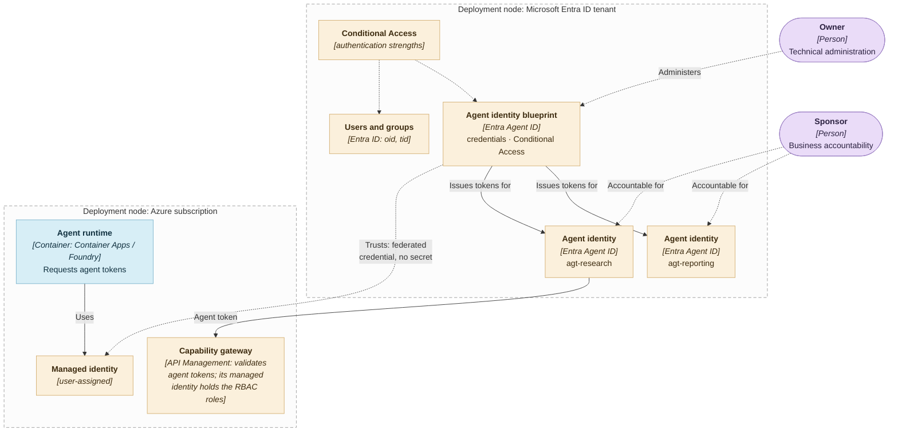

---

## 5. Delegation and attenuation of authority

### 5.1 Architecture

**Concern.** Authentication says *who* an agent is; it does not say *for whom* it acts, *with what authority*, or *for
what purpose*. Passing the user's own token to an agent gives the agent the user's whole authority; giving the agent a
broad standing permission detaches its actions from any person.

**Requirements.** AI Act [Art. 14][aia-14] (oversight relationship), [Art. 26(2)][aia-26] (deployers assign oversight to competent
persons); GDPR [Art. 5(1)(b)][gdpr-5] purpose limitation and [Art. 25][gdpr-25] (least privilege by design).

**Design.** A **delegation service** issues a *delegation* — a signed, short-lived, purpose-bound grant — whenever a
principal starts an agent, and an *attenuated* delegation whenever an agent starts a sub-agent. The delegation context
travels with every call (Appendix B).

- **Scope** is a set of action types on resource types (`documents:read`, `email:draft`), never a role name.
- **Attenuation:** a child delegation's scope must be a subset of its parent's, its expiry no later than its parent's,
  its purpose the same as its parent's, and its mode the same (a delegated chain never becomes autonomous); the
  service refuses to issue anything else.
- **Expiry and revocation:** delegations are short-lived and revocable individually, per agent, or per principal
  (emergency stop, section 8).
- **Checking:** the delegation service is the only issuer and the authority on revocation. On every call the
  capability gateway verifies the delegation's signature and expiry locally and checks a revocation list that the
  delegation service publishes; the PDP decides whether the action is within the delegation's scope and purpose.
  Introspection at the delegation service is a fallback, not the per-call path.
- **Revocation bound:** the organisation sets a maximum time for a revocation to take effect at the gateway (for
  example a few seconds). Revocation-list refresh, cached policy decisions and token lifetimes are configured so that
  none outlives that bound.
- **Two modes, never indistinguishable:** *delegated* (acting within a person's authorised operation) and *autonomous*
  (acting under the organisation's own authority, with a designated supervisor). The mode is recorded on every action.

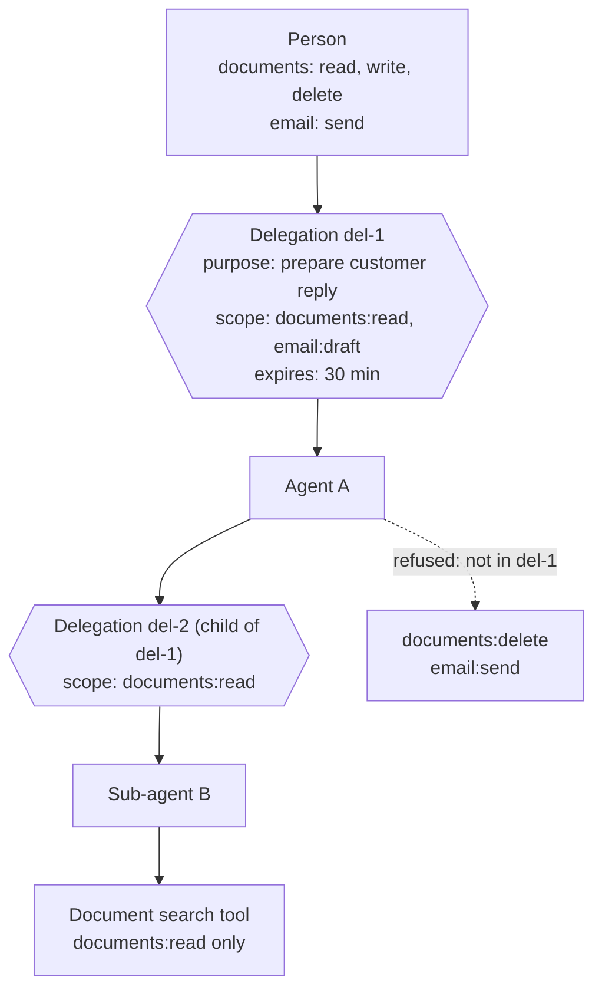

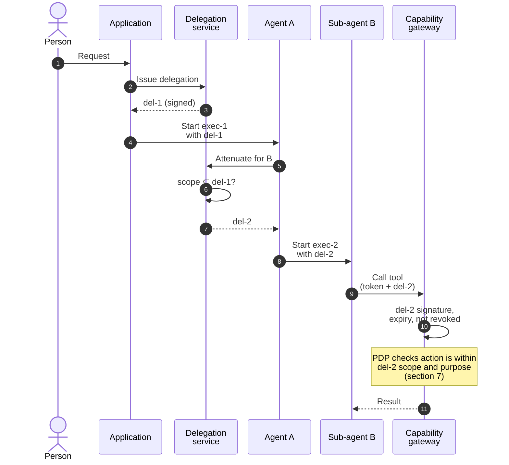

**C4 Component view — delegation service.**

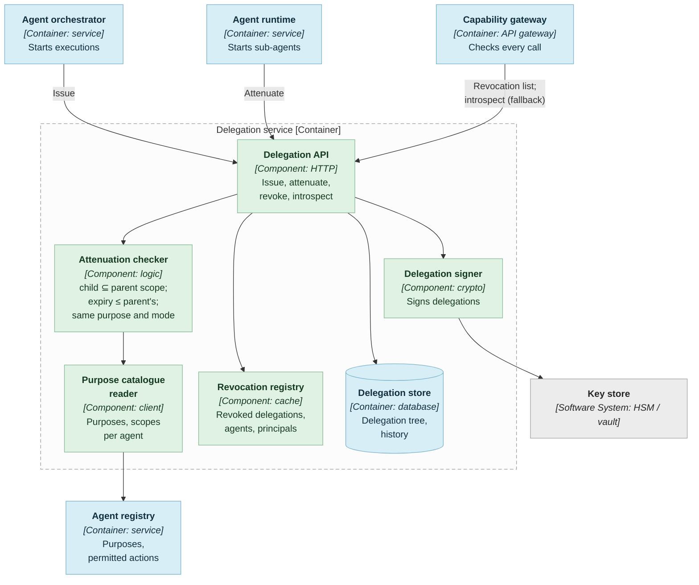

### 5.2 Implementation on Azure

| Element | Azure realisation |
|---|---|
| Person's authority to the application | Entra delegated permissions; the application receives the user's token |
| Application → agent, delegated mode | **On-behalf-of** flow to obtain a token for the agent identity acting for the user (Entra Agent ID interactive agents) — with scopes *narrower* than the user's |
| Agent, autonomous mode | Client-credentials flow of the agent identity (Entra Agent ID autonomous agents), with application permissions limited to its purpose |
| Delegation records | Delegation service on Container Apps; signing keys in **Key Vault** (HSM-backed for production); state in Azure SQL |
| Transport of the delegation | Signed delegation token in a header (`X-Delegation`), validated by **API Management** (`validate-jwt`) and by the PDP |
| Revocation | Revocation list in Azure Cache for Redis, written by the delegation service and read by API Management and the PDP on every call (or cached for less than the revocation bound) |

An Entra token proves *who* the agent is; the delegation token proves *for whom and within what*. Both are required by
the capability gateway; neither alone is enough.

**C4 Deployment view — delegation on Azure.**

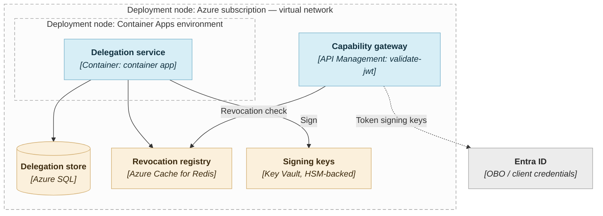

---

## 6. Agent registry and lifecycle

### 6.1 Architecture

**Concern.** An agent that is not known, not versioned, or not owned cannot be governed. The same agent name across two
versions with different instructions or models is not the same component for audit purposes.

**Requirements.** AI Act [Art. 11][aia-11] and [13][aia-13] (technical documentation, instructions for use), [Art. 16–17][aia-16] (provider quality
management), [Art. 26][aia-26] (deployer use according to instructions); GDPR [Art. 30][gdpr-30] (records of processing).

**Design.** An **agent registry** is the single source of truth for what may run. An agent definition version is
immutable and identified by a **configuration hash** over everything that affects behaviour.

| Registry field | Purpose |
|---|---|
| `agentId`, `version`, `configurationHash` | Identity of the exact behaviour |
| `instructionsHash`, `model`, `modelVersion`, `tools[]` with versions | What determines behaviour |
| `purpose`, `riskClass`, `aiActRole` (provider / deployer) | Classification (section 16) |
| `owner`, `sponsor`, `supervisor` | Accountability |
| `permittedActions`, `prohibitedActions`, `oversightPolicy`, `dataPolicy` | Policy inputs (sections 7, 8, 10) |
| `lifecycleState` | Whether it may run |

Gate at execution start: unknown agent, unregistered version, suspended agent, missing supervisor or missing delegation
→ **deny**.

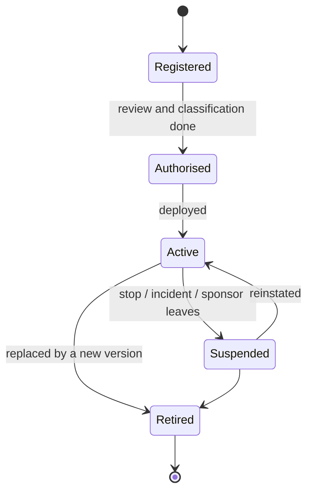

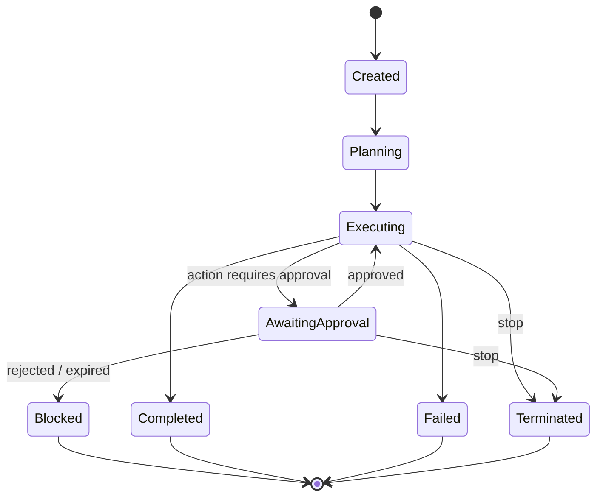

**C4 Component view — agent registry.**

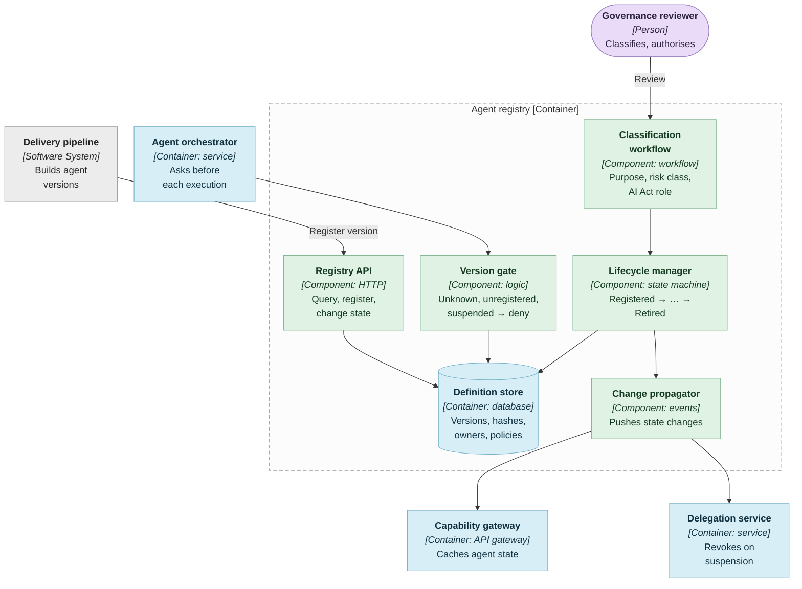

### 6.2 Implementation on Azure

| Element | Azure realisation |
|---|---|
| Registry service | Container Apps service, state in Azure SQL (relational, auditable history with temporal tables) |
| Agent identity lifecycle | Entra Agent ID agent identities created from blueprints; sponsors and owners on each; lifecycle workflows (where licensed) disable identities whose sponsor leaves |
| Deployment gate | CI/CD pipeline step that registers a new version and refuses to deploy an unregistered one; runtime gate in the orchestrator |
| Model inventory | Microsoft Foundry / Azure Machine Learning registry for model versions referenced by the registry |
| Suspension | Registry state change propagated to API Management (cached policy) and to the delegation service (revocation) |

**C4 Deployment view — agent registry on Azure.**

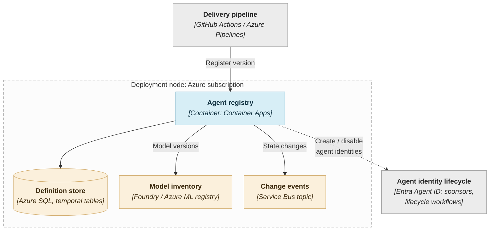

---

## 7. Authorization and policy enforcement

### 7.1 Architecture

**Concern.** An agent that decides for itself whether an action is allowed is not controlled. Authorization must sit
on the path between the agent and the capability, outside the agent.

**Requirements.** AI Act [Art. 14(4)(e)][aia-14] (ability to interrupt), [Art. 15][aia-15] (robustness, cybersecurity); GDPR [Art. 25][gdpr-25] and
[32][gdpr-32].

**Design.** Agents never hold direct credentials to capabilities. They call a **capability gateway** (PEP), which asks
a **policy decision point** with the full context. Decisions: `PERMIT`, `DENY`, `REQUIRE_HUMAN_APPROVAL`.

Policy inputs: agent identity and registry entry, delegation and its scope, action type, resource, **risk tier** of the
action, data classification, time and context.

| Risk tier | Examples | Default decision |
|---|---|---|
| R0 — Read | Search, retrieve, summarise | Permit within scope |
| R1 — Internal write | Draft, annotate, save to the user's workspace | Permit within scope |
| R2 — External communication / data egress | Send a message, call an external service, speak to people | Policy: permit, or require approval |
| R3 — Consequential change | Modify records, publish, financial operations | Require approval |
| R4 — Decision about a person / irreversible | Decisions with legal or similarly significant effects, deletion | Require approval with strong authentication; GDPR Art. 22 safeguards |

An action that needs approval is **held by the capability gateway**, keyed by the hash of the exact request; the agent
receives an action id and never holds an approval token. When the approval arrives, the gateway executes the held
request unchanged and returns the result to the execution; if it is rejected or expires, the gateway returns the
refusal (section 8).

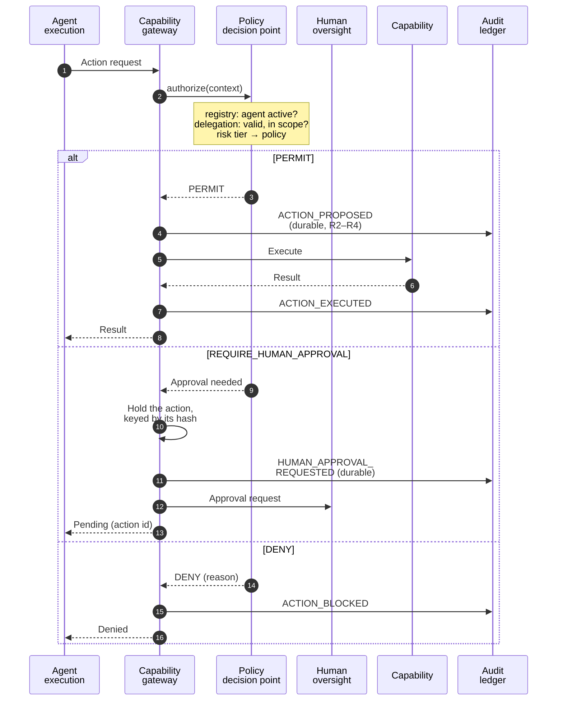

**C4 Component view — capability gateway (policy enforcement point).**

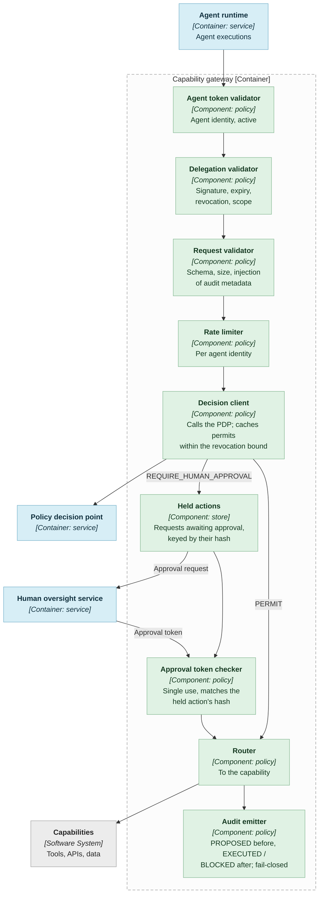

**C4 Component view — policy decision point.**

```mermaid
%%{init: {"flowchart": {"wrappingWidth": 210, "nodeSpacing": 28, "rankSpacing": 55, "curve": "basis"}}}%%
flowchart TB
    pep["<b>Capability gateway</b><br/><i>[Container: API gateway]</i><br/>Asks for a decision"]:::container
    subgraph PDP["Policy decision point [Container]"]
    api["<b>Decision API</b><br/><i>[Component: HTTP]</i><br/>authorize(context)"]:::component
    cr["<b>Context resolver</b><br/><i>[Component: logic]</i><br/>Agent facts, delegation,<br/>data classification"]:::component
    rc["<b>Risk classifier</b><br/><i>[Component: rules]</i><br/>Action → R0 … R4"]:::component
    ev["<b>Policy evaluator</b><br/><i>[Component: policy engine]</i><br/>Rules → decision,<br/>policy id and version"]:::component
    pb[("<b>Policy bundles</b><br/><i>[Container: signed, versioned]</i><br/>Policies as code")]:::container
    dl["<b>Decision log</b><br/><i>[Component: events]</i><br/>POLICY_DECISION"]:::component
    end
    reg["<b>Agent registry</b><br/><i>[Container: service]</i><br/>"]:::container
    del["<b>Delegation service</b><br/><i>[Container: service]</i><br/>"]:::container
    cat["<b>Data catalogue</b><br/><i>[Software System]</i><br/>Classifications, labels"]:::external
    pep --> api --> cr
    cr --> reg & del & cat
    cr --> rc --> ev
    ev --> pb
    ev --> dl
    class PDP boundary
    classDef person fill:#eadcf8,stroke:#9d82c4,color:#2b2140
    classDef system fill:#d3e5f8,stroke:#7fa6cf,color:#15283d
    classDef external fill:#ececec,stroke:#a3a3a3,color:#262626
    classDef container fill:#d7eef6,stroke:#78b2cb,color:#10303f
    classDef component fill:#e0f2e4,stroke:#86b893,color:#163a22
    classDef boundary fill:#fcfcfc,stroke:#9a9a9a,stroke-dasharray:6 4,color:#333333
    classDef infra fill:#fbf0dc,stroke:#d2ad6f,color:#3d2b0f
```

### 7.2 Implementation on Azure

| Element | Azure realisation |
|---|---|
| Capability gateway | **Azure API Management**: `validate-jwt` for the agent identity token and the delegation token, `send-request` to the PDP, rate limits per agent identity, request validation, injection of audit metadata |
| PDP | Policy engine as a service on Container Apps (for example Open Policy Agent with policies in source control), policy bundles versioned and signed |
| Azure-native data | Entra authentication + **Azure RBAC** assigned to API Management's managed identity (per product where finer separation is needed) with the narrowest built-in role (for example *Search Index Data Reader*, *Storage Blob Data Reader*) — no API keys, and no data-plane roles for agent identities, so an agent token is useless outside the gateway |
| Network | Capabilities on private endpoints in their own subnet; network security groups allow traffic to it only from the API Management subnet, so agent runtimes in the same virtual network cannot reach the endpoints directly |

**C4 Deployment view — authorization on Azure.**

```mermaid
%%{init: {"flowchart": {"wrappingWidth": 210, "nodeSpacing": 28, "rankSpacing": 55, "curve": "basis"}}}%%
flowchart TB
    subgraph VNET["Deployment node: virtual network"]
        subgraph APIM["Deployment node: Azure API Management (internal)"]
            pol["<b>Policies</b><br/><i>[validate-jwt · rate-limit-by-key ·<br/>send-request to PDP · set-header]</i>"]:::container
        end
        subgraph ACA["Deployment node: Container Apps environment"]
    pdp["<b>Policy decision point</b><br/><i>[Container: Open Policy Agent]</i><br/>Signed bundles"]:::container
    rt["<b>Agent runtime</b><br/><i>[Container: container apps]</i><br/>"]:::container
        end
        pe["<b>Azure data services</b><br/><i>[private endpoints,<br/>Entra auth + RBAC — no keys]</i>"]:::infra
    end
    repo["<b>Policy repository</b><br/><i>[source control → bundle]</i>"]:::external
    rt -->|"Every action"| pol
    pol -->|"Decision request"| pdp
    pol --> pe
    repo -->|"Signed bundle"| pdp
    class VNET,APIM,ACA boundary
    classDef person fill:#eadcf8,stroke:#9d82c4,color:#2b2140
    classDef system fill:#d3e5f8,stroke:#7fa6cf,color:#15283d
    classDef external fill:#ececec,stroke:#a3a3a3,color:#262626
    classDef container fill:#d7eef6,stroke:#78b2cb,color:#10303f
    classDef component fill:#e0f2e4,stroke:#86b893,color:#163a22
    classDef boundary fill:#fcfcfc,stroke:#9a9a9a,stroke-dasharray:6 4,color:#333333
    classDef infra fill:#fbf0dc,stroke:#d2ad6f,color:#3d2b0f
```

---

## 8. Human oversight

### 8.1 Architecture

**Concern.** "A human in the loop" is meaningless unless a designated person can understand, monitor, approve, override
and stop the system, and the system makes that possible structurally.

**Requirements.** AI Act [Art. 14][aia-14] (for high-risk systems: understand capacities and limits, awareness of automation
bias, interpret output, decide not to use or override, interrupt through a stop procedure), [Art. 26(2)][aia-26] (competent
overseers with authority), [Art. 4][aia-4] (AI literacy); GDPR [Art. 22(3)][gdpr-22] (right to human intervention for automated decisions).

**Design.** A **human oversight service** owns every oversight interaction; agents cannot approve, bypass or forge
them.

| Capability | Behaviour |
|---|---|
| Approval request / decision | Created by the PEP; shows the proposed action, its reason, the data concerned, the risk and the policy; decided by an eligible approver with sufficient authentication strength |
| Override / reversal | Replace or undo an output; recorded with the original |
| Pause / resume / terminate | Per execution, per agent, per principal, or globally ("emergency stop") — enforced through delegation revocation and registry suspension, and by telling the agent runtime to terminate the executions in scope that are already running |
| Escalation | Timeouts route to a deputy or a higher role |

Four human roles are recorded separately: **initiator** (asked for it), **supervisor** (responsible for the agent's
operation), **approver** (authorised this action), **affected person** (whose interests the action concerns).

**Eligibility of approvers** (separation of duties): the approver of an action is never its initiator, nor the
affected person; eligible approvers come from the responsibility matrix (section 16), which records the training that
makes them competent to oversee the agent (Art. 26(2); Art. 4 as amended asks for measures supporting AI literacy rather
than a guaranteed level, so the required training is an organisational policy), and lapsed training removes
eligibility; policy may require two
independent approvers (dual control) for R4 actions and for R3 actions above a threshold, each approval recorded as its
own `HUMAN_APPROVED` event.

Oversight is proportional: R0–R1 actions run under the supervisor's standing responsibility ("human on the loop"); R3–R4
always escalate to a human ("human in the loop"); R2 escalates where policy says so.

```mermaid
%%{init: {"sequence": {"actorMargin": 18, "width": 118, "messageFontSize": 13, "noteFontSize": 13, "wrap": false}}}%%
sequenceDiagram
    autonumber
    participant AG as Agent<br/>execution
    participant PEP as Capability<br/>gateway
    participant HOS as Oversight<br/>service
    actor APR as Approver
    participant LED as Audit<br/>ledger
    participant CAP as Capability
    PEP->>HOS: Approval request<br/>(held action's hash)
    HOS->>APR: Notify: what, why,<br/>risk, deadline
    APR->>HOS: Open the request
    HOS->>HOS: Eligible? Not the<br/>initiator or affected
    HOS->>APR: Step-up<br/>authentication
    APR->>HOS: Approve / reject /<br/>stop agent
    HOS->>LED: HUMAN_APPROVED or<br/>HUMAN_REJECTED (durable)
    alt approved
        HOS-->>PEP: Single-use token,<br/>bound to the action hash
        PEP->>LED: ACTION_PROPOSED (durable)
        PEP->>CAP: Execute exactly<br/>the held action
        CAP-->>PEP: Result
        PEP->>LED: ACTION_EXECUTED
        PEP-->>AG: Result for the action id
    else rejected, expired or stopped
        HOS-->>PEP: Refusal
        PEP->>LED: ACTION_BLOCKED
        PEP-->>AG: Blocked / terminated
    end
```

```mermaid
flowchart LR
    STOP(["Emergency stop<br/>(principal / agent / global)"]) --> REV["Revoke delegations"]
    STOP --> SUS["Suspend agent in registry"]
    STOP --> TRM["Signal the runtime"]
    REV --> PEP1["Gateway refuses<br/>every call of the scope;<br/>held actions dropped"]
    SUS --> ORC1["Orchestrator refuses<br/>new executions"]
    TRM --> RT1["Runtime terminates<br/>running executions<br/>of the scope"]
    STOP --> LED1["Ledger: AGENT_STOPPED"]
```

**C4 Component view — human oversight service, approval path.**

```mermaid
%%{init: {"flowchart": {"wrappingWidth": 210, "nodeSpacing": 28, "rankSpacing": 55, "curve": "basis"}}}%%
flowchart TB
    pep["<b>Capability gateway</b><br/><i>[Container: API gateway]</i><br/>Requests approval"]:::container
    apr(["<b>Approver</b><br/><i>[Person]</i><br/>Eligible for the action's<br/>risk and policy"]):::person
    subgraph HOS["Human oversight service — approval path [Container]"]
    api["<b>Oversight API</b><br/><i>[Component: HTTP]</i><br/>Requests, decisions;<br/>approver eligibility"]:::component
    q["<b>Approval queue</b><br/><i>[Component: queue]</i><br/>Pending, deadlines,<br/>escalation"]:::component
    ntf["<b>Notifier</b><br/><i>[Component: adapter]</i><br/>Tells the approver<br/>a decision is waiting"]:::component
    ui["<b>Oversight UI</b><br/><i>[Component: web]</i><br/>What, why, data,<br/>risk, policy"]:::component
    su["<b>Step-up<br/>authentication</b><br/><i>[Component: client]</i><br/>Required<br/>assurance level"]:::component
    ats["<b>Approval token signer</b><br/><i>[Component: crypto]</i><br/>Single-use token, bound to<br/>the action's hash, returned<br/>to the gateway"]:::component
    st[("<b>Oversight store</b><br/><i>[Container: database]</i><br/>Requests,<br/>decisions")]:::container
    end
    pep -->|"Approval request"| api
    apr -->|"Opens, decides"| ui
    api --> q --> ntf
    ui --> su
    ui -->|"Decision"| api
    api --> ats
    api --> st
    class HOS boundary
    classDef person fill:#eadcf8,stroke:#9d82c4,color:#2b2140
    classDef system fill:#d3e5f8,stroke:#7fa6cf,color:#15283d
    classDef external fill:#ececec,stroke:#a3a3a3,color:#262626
    classDef container fill:#d7eef6,stroke:#78b2cb,color:#10303f
    classDef component fill:#e0f2e4,stroke:#86b893,color:#163a22
    classDef boundary fill:#fcfcfc,stroke:#9a9a9a,stroke-dasharray:6 4,color:#333333
    classDef infra fill:#fbf0dc,stroke:#d2ad6f,color:#3d2b0f
```

**C4 Component view — human oversight service, stop path.**

```mermaid
%%{init: {"flowchart": {"wrappingWidth": 210, "nodeSpacing": 28, "rankSpacing": 55, "curve": "basis"}}}%%
flowchart TB
    sup(["<b>Supervisor</b><br/><i>[Person]</i><br/>Responsible for<br/>the agent's operation"]):::person
    subgraph HOS["Human oversight service — stop path [Container]"]
    ui["<b>Oversight UI</b><br/><i>[Component: web]</i><br/>Pause, resume,<br/>terminate"]:::component
    stop["<b>Stop controller</b><br/><i>[Component: logic]</i><br/>Scope: execution,<br/>agent, principal, all"]:::component
    aud["<b>Audit emitter</b><br/><i>[Component: events]</i><br/>AGENT_STOPPED"]:::component
    end
    del["<b>Delegation service</b><br/><i>[Container: service]</i><br/>Revokes delegations<br/>in scope"]:::container
    reg["<b>Agent registry</b><br/><i>[Container: service]</i><br/>Suspends agent<br/>versions"]:::container
    pep["<b>Capability gateway</b><br/><i>[Container: API gateway]</i><br/>Refuses calls<br/>in scope"]:::container
    orc["<b>Agent orchestrator</b><br/><i>[Container: service]</i><br/>Refuses new<br/>executions"]:::container
    rt["<b>Agent runtime</b><br/><i>[Container: service]</i><br/>Terminates running<br/>executions in scope"]:::container
    sup --> ui --> stop
    stop --> aud
    stop --> del --> pep
    stop --> reg --> orc
    stop -->|"Terminate"| rt
    class HOS boundary
    classDef person fill:#eadcf8,stroke:#9d82c4,color:#2b2140
    classDef system fill:#d3e5f8,stroke:#7fa6cf,color:#15283d
    classDef external fill:#ececec,stroke:#a3a3a3,color:#262626
    classDef container fill:#d7eef6,stroke:#78b2cb,color:#10303f
    classDef component fill:#e0f2e4,stroke:#86b893,color:#163a22
    classDef boundary fill:#fcfcfc,stroke:#9a9a9a,stroke-dasharray:6 4,color:#333333
    classDef infra fill:#fbf0dc,stroke:#d2ad6f,color:#3d2b0f
```

### 8.2 Implementation on Azure

| Element | Azure realisation |
|---|---|
| Oversight service | Container Apps service with a queue (Azure Service Bus) of pending approvals; state in Azure SQL |
| Approver notification | Microsoft Teams adaptive cards or e-mail through Azure Communication Services, linking to the oversight UI — the decision itself is taken in the oversight UI, not in the message |
| Strong authentication | Entra **Conditional Access authentication strengths** (for example phishing-resistant MFA) required for the approval application |
| Approval binding | Approval token signed with a Key Vault key, single use, bound to the hash of the approved action |
| Emergency stop | Registry suspension + delegation revocation list (Azure Cache for Redis) read by API Management on every call + a stop event on a Service Bus topic to which the agent runtimes subscribe to terminate running executions; Entra Agent ID agent identity can additionally be disabled |
| Separation of duties | Eligible approvers as Entra groups from the responsibility matrix; the oversight service rejects a decision by the initiator or the affected person, and enforces dual control where policy requires it |

**C4 Deployment view — human oversight on Azure.**

```mermaid
%%{init: {"flowchart": {"wrappingWidth": 210, "nodeSpacing": 28, "rankSpacing": 55, "curve": "basis"}}}%%
flowchart TB
    ent["<b>Entra ID</b><br/><i>[Conditional Access<br/>authentication strengths]</i>"]:::external
    subgraph SUB["Deployment node: Azure subscription"]
        subgraph ACA["Deployment node: Container Apps environment"]
    hos["<b>Oversight service and UI</b><br/><i>[Container: container app]</i><br/>"]:::container
        end
        sb["<b>Approval queue · stop topic</b><br/><i>[Service Bus]</i>"]:::infra
        sql[("<b>Oversight store</b><br/><i>[Azure SQL]</i>")]:::infra
        kv["<b>Approval token keys</b><br/><i>[Key Vault]</i>"]:::infra
        redis["<b>Revocation registry</b><br/><i>[Azure Cache<br/>for Redis]</i>"]:::infra
        acs["<b>Notifications</b><br/><i>[Teams cards · Communication<br/>Services e-mail]</i>"]:::infra
    end
    hos -->|"Step-up"| ent
    hos --> sb & sql & kv
    sb ~~~ redis
    sql ~~~ acs
    hos -->|"Stop"| redis
    hos --> acs
    class SUB,ACA boundary
    classDef person fill:#eadcf8,stroke:#9d82c4,color:#2b2140
    classDef system fill:#d3e5f8,stroke:#7fa6cf,color:#15283d
    classDef external fill:#ececec,stroke:#a3a3a3,color:#262626
    classDef container fill:#d7eef6,stroke:#78b2cb,color:#10303f
    classDef component fill:#e0f2e4,stroke:#86b893,color:#163a22
    classDef boundary fill:#fcfcfc,stroke:#9a9a9a,stroke-dasharray:6 4,color:#333333
    classDef infra fill:#fbf0dc,stroke:#d2ad6f,color:#3d2b0f
```

---

## 9. Transparency towards people

### 9.1 Architecture

**Concern.** People who talk to, listen to or read the output of an agent must know it is an AI system; content an
agent generates must be identifiable as such.

**Requirements.** AI Act [Art. 50][aia-50] (applies since 2 August 2026): [Art. 50(1)][aia-50] systems intended to interact directly with
natural persons are designed so those persons are informed they interact with an AI system, unless obvious; [Art. 50(2)][aia-50]
synthetic audio, image, video or text output is marked in a machine-readable format and detectable as artificially
generated; [Art. 50(4)][aia-50] disclosure of deep fakes and of AI-generated text published to inform the public. GDPR [Art. 13–14][gdpr-13]
(information to data subjects), [Art. 22][gdpr-22] (automated decision-making).

**Design.**

- **Actor type is part of identity.** Every message, utterance or document the platform emits carries `actorType`
  (`human` | `ai_agent`) from the identity layer, so disclosure is not left to individual user interfaces.
- **Disclosure at first contact** in every channel: a visible label in text interfaces; a spoken announcement when an
  agent joins a voice conversation; a statement in generated documents.
- **Marking of generated content**: machine-readable provenance metadata on generated media and documents; human-visible
  labelling where content is published.
- **Explanations on request**: what the agent is, who is responsible, how to reach a human.

**C4 Component view — disclosure components.**

```mermaid
%%{init: {"flowchart": {"wrappingWidth": 210, "nodeSpacing": 28, "rankSpacing": 55, "curve": "basis"}}}%%
flowchart TB
    rt["<b>Agent runtime</b><br/><i>[Container: service]</i><br/>Messages, speech,<br/>documents, media"]:::container
    subgraph TR["Disclosure components [in user interfaces and runtime]"]
    atr["<b>Actor-type resolver</b><br/><i>[Component: library]</i><br/>human | ai_agent<br/>from the identity"]:::component
    pol["<b>Disclosure policy</b><br/><i>[Component: configuration]</i><br/>Per channel: when,<br/>how, wording"]:::component
    txt["<b>Text labeller</b><br/><i>[Component: UI component]</i><br/>Visible AI label"]:::component
    voi["<b>Voice announcer</b><br/><i>[Component: adapter]</i><br/>Spoken notice<br/>on joining"]:::component
    doc["<b>Document stamper</b><br/><i>[Component: adapter]</i><br/>Statement +<br/>provenance metadata"]:::component
    med["<b>Media marker</b><br/><i>[Component: adapter]</i><br/>Machine-readable<br/>marking"]:::component
    rec["<b>Disclosure recorder</b><br/><i>[Component: events]</i><br/>DISCLOSURE_GIVEN"]:::component
    end
    aff(["<b>Person interacting</b><br/><i>[Person]</i><br/>Is told it is<br/>an AI system"]):::person
    rt --> atr --> pol
    pol --> txt & voi
    txt ~~~ doc
    voi ~~~ med
    pol --> doc & med
    doc ~~~ rec
    txt & voi & doc & med -.-> rec
    TR -->|"Labelled, announced,<br/>marked output"| aff
    class TR boundary
    classDef person fill:#eadcf8,stroke:#9d82c4,color:#2b2140
    classDef system fill:#d3e5f8,stroke:#7fa6cf,color:#15283d
    classDef external fill:#ececec,stroke:#a3a3a3,color:#262626
    classDef container fill:#d7eef6,stroke:#78b2cb,color:#10303f
    classDef component fill:#e0f2e4,stroke:#86b893,color:#163a22
    classDef boundary fill:#fcfcfc,stroke:#9a9a9a,stroke-dasharray:6 4,color:#333333
    classDef infra fill:#fbf0dc,stroke:#d2ad6f,color:#3d2b0f
```

### 9.2 Implementation on Azure

| Element | Azure realisation |
|---|---|
| Actor type | Claim or attribute on the Entra Agent ID agent identity, propagated in tokens and in the delegation context |
| Text channels | UI component library with a mandatory AI label; in Microsoft Teams, the bot's name, profile and first message say it is an AI system |
| Voice | Announcement synthesised with Azure AI Speech at the start of the agent's participation, recorded in the ledger |
| Content marking | Content credentials (C2PA-style manifests) where the generating service supports them; provenance metadata stored with the document in Azure Storage |
| Evidence | `DISCLOSURE_GIVEN` events in the audit stream (section 12) |

**C4 Deployment view — transparency on Azure.**

```mermaid
%%{init: {"flowchart": {"wrappingWidth": 210, "nodeSpacing": 28, "rankSpacing": 55, "curve": "basis"}}}%%
flowchart TB
    ent["<b>Agent identity</b><br/><i>[Entra Agent ID: actor type]</i>"]:::external
    subgraph SUB["Deployment node: Azure subscription"]
    ui["<b>User interfaces</b><br/><i>[Container: Container Apps / Static Web Apps]</i><br/>AI label component"]:::container
    rt["<b>Agent runtime</b><br/><i>[Container: Container Apps]</i><br/>Voice announcer,<br/>document stamper"]:::container
        sp["<b>Speech</b><br/><i>[Azure AI Speech]</i>"]:::infra
        st["<b>Generated documents</b><br/><i>[Storage: provenance metadata]</i>"]:::infra
    end
    teams["<b>Microsoft Teams</b><br/><i>[bot profile, first message]</i>"]:::external
    ent -.-> rt
    rt --> sp
    rt --> st
    rt --> teams
    class SUB boundary
    classDef person fill:#eadcf8,stroke:#9d82c4,color:#2b2140
    classDef system fill:#d3e5f8,stroke:#7fa6cf,color:#15283d
    classDef external fill:#ececec,stroke:#a3a3a3,color:#262626
    classDef container fill:#d7eef6,stroke:#78b2cb,color:#10303f
    classDef component fill:#e0f2e4,stroke:#86b893,color:#163a22
    classDef boundary fill:#fcfcfc,stroke:#9a9a9a,stroke-dasharray:6 4,color:#333333
    classDef infra fill:#fbf0dc,stroke:#d2ad6f,color:#3d2b0f
```

---

## 10. Personal data protection

### 10.1 Architecture

**Concern.** Agents read, combine and generate personal data at scale, and their observability, audit and evidence
layers can become a second, uncontrolled copy of that data.

**Requirements.** GDPR [Art. 5][gdpr-5] (lawfulness, purpose limitation, minimisation, accuracy, storage limitation, integrity),
[Art. 6][gdpr-6] and [9][gdpr-9] (lawful basis, special categories), [Art. 12–22][gdpr-12] (rights, including access, erasure, objection and automated
decisions), [Art. 25][gdpr-25] (by design and by default), [Art. 28][gdpr-28] (processors), [Art. 30][gdpr-30] (records), [Art. 32][gdpr-32] (security), [Art. 35][gdpr-35]
(impact assessment), [Chapter V][gdpr-cpt-V] (transfers); AI Act [Art. 10][aia-10] (data governance for high-risk systems), [Art. 26(9)][aia-26] (deployer
DPIA using the provider's information).

**Design.**

| Control | Design rule |
|---|---|
| Purpose binding | Every delegation names a purpose from the registry; data access outside it is denied by the PDP |
| Minimisation in the chain | Logs, traces and the ledger record identifiers, counts and keyed hashes — never content people wrote or said (invariant I4). Identifiers of resources that designate a person (a customer record, a case) are pseudonymised like people's subject ids |
| Pseudonymisation | People appear in telemetry and evidence as a keyed pseudonym of their subject id (HMAC with a key held by the pseudonymisation service). Linking a pseudonym back to a person needs that service, which keeps the pseudonym-to-subject mapping apart from the evidence and releases it only to the authorised re-identification role |
| Content hashes | Hashes of inputs and outputs are keyed (HMAC-SHA-256), because plain hashes of short or predictable content (an account number, a yes/no decision) can be reversed by guessing. Pseudonyms and content hashes remain personal data under the GDPR and are governed as such |
| Retention | Each store has a declared retention matching its purpose; operational telemetry short, evidence as long as the legal obligation |
| Data subject rights | An index from subject id to the stores holding their data, including agent memories and conversation stores; erasure removes content and keeps only pseudonymised evidence where a legal obligation requires it |
| Model context | Only the data the delegation's purpose needs is placed in a model's context; prompts and responses kept only where the purpose requires it |
| Processors and transfers | Model and tool providers are processors under contract; data residency in the EU or covered by a transfer mechanism |
| DPIA | Required before deploying agents that process personal data at scale or decide about people; reviewed when the agent definition changes materially |

```mermaid
flowchart TB
    subgraph CONTENT["Content stores — personal data, purpose-bound"]
        CONV["Conversations · documents · recordings"]
    end
    subgraph TELE["Telemetry — no content"]
        LOGS["Logs · traces<br/>userId = pseudonym"]
    end
    subgraph EVI["Evidence — no content"]
        LEDG["Ledger<br/>pseudonym + hashes"]
    end
    KEY[("Pseudonym key<br/>held separately")]
    IDX["Subject index<br/>(rights requests)"]
    CONV -->|ids, counts, hashes| LOGS
    CONV -->|ids, hashes| LEDG
    KEY -. authorised re-identification .-> LEDG
    IDX --> CONV
    IDX -. pseudonym .-> LEDG
```

**C4 Component view — personal data protection.**

```mermaid
%%{init: {"flowchart": {"wrappingWidth": 210, "nodeSpacing": 28, "rankSpacing": 55, "curve": "basis"}}}%%
flowchart TB
    ds(["<b>Data subject</b><br/><i>[Person]</i><br/>Exercises rights"]):::person
    dpo(["<b>Data protection officer</b><br/><i>[Person]</i><br/>Approves<br/>re-identification"]):::person
    subgraph PRIV["Personal data protection [Containers and components]"]
    rro["<b>Rights request<br/>orchestrator</b><br/><i>[Container: workflow]</i><br/>Access, erasure,<br/>objection"]:::container
    psd["<b>Pseudonymisation<br/>service</b><br/><i>[Container: service]</i><br/>Keyed pseudonyms"]:::container
    sidx["<b>Subject index</b><br/><i>[Container: service]</i><br/>Subject → stores"]:::container
    ret["<b>Retention scheduler</b><br/><i>[Container: jobs]</i><br/>Deletes per<br/>declared retention"]:::container
    pb["<b>Purpose binding</b><br/><i>[Component: PDP rule set]</i><br/>Access only for the<br/>delegation's purpose"]:::component
    end
    cs[("<b>Content stores</b><br/><i>[Container: databases]</i><br/>Conversations, documents,<br/>memories, recordings")]:::container
    ev[("<b>Telemetry and evidence</b><br/><i>[Container: stores]</i><br/>Pseudonyms and<br/>hashes only")]:::container
    ds --> rro --> sidx
    dpo -->|"Authorised<br/>re-identification"| psd
    sidx ~~~ ret
    psd ~~~ pb
    sidx --> cs
    ret --> cs & ev
    rro -.->|"Evidence kept<br/>where law requires"| ev
    psd -.-> ev
    pb -.->|"Guards"| cs
    class PRIV boundary
    classDef person fill:#eadcf8,stroke:#9d82c4,color:#2b2140
    classDef system fill:#d3e5f8,stroke:#7fa6cf,color:#15283d
    classDef external fill:#ececec,stroke:#a3a3a3,color:#262626
    classDef container fill:#d7eef6,stroke:#78b2cb,color:#10303f
    classDef component fill:#e0f2e4,stroke:#86b893,color:#163a22
    classDef boundary fill:#fcfcfc,stroke:#9a9a9a,stroke-dasharray:6 4,color:#333333
    classDef infra fill:#fbf0dc,stroke:#d2ad6f,color:#3d2b0f
```

### 10.2 Implementation on Azure

| Element | Azure realisation |
|---|---|
| Data residency | EU regions for all resources, including model deployments (EU Data Zone deployments of Azure OpenAI where used) |
| Classification and discovery | Microsoft Purview data map and sensitivity labels; labels as PDP inputs |
| Pseudonym and hash keys | Key Vault or Managed HSM keys for pseudonyms and content hashes, used only by the pseudonymisation service's managed identity; the pseudonym-to-subject mapping readable only by the re-identification role, every access logged |
| Encryption | Platform encryption at rest; customer-managed keys in Key Vault for evidence and content stores where required |
| Rights requests | Subject index in Azure SQL; erasure workflows as Durable Functions or Container Apps jobs |
| Records of processing | Purview and the registry's `purpose` and `dataPolicy` fields exported to the records of processing |

**C4 Deployment view — personal data protection on Azure.**

```mermaid
%%{init: {"flowchart": {"wrappingWidth": 210, "nodeSpacing": 28, "rankSpacing": 55, "curve": "basis"}}}%%
flowchart TB
    subgraph EU["Deployment node: Azure — EU regions only"]
        pur["<b>Classification, data map</b><br/><i>[Microsoft Purview]</i>"]:::infra
        kv["<b>Pseudonym key</b><br/><i>[Key Vault / Managed HSM]</i>"]:::infra
        sql[("<b>Subject index</b><br/><i>[Azure SQL]</i>")]:::infra
        fn["<b>Rights and retention workflows</b><br/><i>[Durable Functions / Container Apps jobs]</i>"]:::infra
        aoai["<b>Models</b><br/><i>[Azure OpenAI — EU Data Zone]</i>"]:::infra
        cmk["<b>Content and evidence stores</b><br/><i>[customer-managed keys]</i>"]:::infra
    end
    fn --> sql --> cmk
    fn -->|"Re-identification<br/>(authorised role)"| kv
    pur -.->|"Labels as policy inputs"| cmk
    class EU boundary
    classDef person fill:#eadcf8,stroke:#9d82c4,color:#2b2140
    classDef system fill:#d3e5f8,stroke:#7fa6cf,color:#15283d
    classDef external fill:#ececec,stroke:#a3a3a3,color:#262626
    classDef container fill:#d7eef6,stroke:#78b2cb,color:#10303f
    classDef component fill:#e0f2e4,stroke:#86b893,color:#163a22
    classDef boundary fill:#fcfcfc,stroke:#9a9a9a,stroke-dasharray:6 4,color:#333333
    classDef infra fill:#fbf0dc,stroke:#d2ad6f,color:#3d2b0f
```

---

## 11. Logging and telemetry

### 11.1 Architecture

**Concern.** Agents multiply the number of steps per request (model calls, retrievals, tool calls, sub-agents).
Without a single schema and trace context, the steps cannot be correlated; without discipline, logs become a leak of
personal data and an uncontrolled cost.

**Requirements.** The centralized logging standard (structured JSON schema, OpenTelemetry, W3C Trace Context, OTLP to a
collector gateway, no vendor integration in code, platform of record, no personal data or secrets, cost-aware,
fail-open); AI Act [Art. 12][aia-12] (automatic recording of events over the lifetime); GDPR [Art. 5(1)(c)][gdpr-5], [25][gdpr-25], [32][gdpr-32].

**Design.**

- **Instrumentation** with OpenTelemetry SDKs in every component. Inbound requests join the caller's W3C `traceparent`
  (a trace starts only at the platform's entry point when none is received); every outbound call propagates it; trace
  and span identifiers come from the SDK, never from application code.
- **One JSON object per log record**, with a fixed schema:

| Field | Rule |
|---|---|
| `timestamp` | ISO 8601 UTC |
| `level` | `TRACE`, `DEBUG`, `INFO`, `WARN`, `ERROR`, `FATAL` |
| `message` | Free text, only here; no personal data |
| `service`, `env`, `version`, `host` | Origin |
| `traceId`, `spanId` | Whenever inside a trace |
| `correlationId` | Business flow identifier, when one exists |
| `userId` | Pseudonym, never an address or name |
| `http.method`, `http.route`, `http.status_code` | Inside HTTP requests (route template, not path) |
| `err.type`, `err.message`, `err.stack` | Errors only, masked |
| Agent fields (custom, lowerCamelCase) | `agentId`, `agentVersion`, `executionId`, `parentExecutionId`, `delegationId`, `modelId` |

- **Agent-specific spans**: agent execution, model invocation (model, version, token counts — not prompts), retrieval,
  tool call, policy decision, approval. Prompts and completions are not exported as span attributes.
- **Defence in depth against leaks**: call sites log identifiers only; a filter in the logging pipeline masks
  address-like values and drops URL query strings before export.
- **Transport**: OTLP from every component to a **collector gateway**; only the gateway knows the platform of record and
  its routing (indexes are chosen there, never in code). Export is batched and asynchronous; a collector outage loses
  telemetry, never a request. Audit events do not travel this fail-open path; they have their own (section 12).
- **Volume**: INFO in production; DEBUG only time-boxed; no per-call library noise, no health-check logging, sampling
  for high-volume paths, a size cap on messages.

**C4 Component view — telemetry inside any container.**

```mermaid
%%{init: {"flowchart": {"wrappingWidth": 210, "nodeSpacing": 28, "rankSpacing": 55, "curve": "basis"}}}%%
flowchart TB
    subgraph CMP["Any container of the platform"]
    ins["<b>Instrumentation</b><br/><i>[Component: OpenTelemetry SDK]</i><br/>Inbound: join traceparent;<br/>outbound: propagate it"]:::component
    app["<b>Application code</b><br/><i>[Component: service code]</i><br/>Logs ids, counts, lengths<br/>— never content"]:::component
    enr["<b>Context enricher</b><br/><i>[Component: logging filter]</i><br/>userId pseudonym,<br/>correlationId, agent fields,<br/>http.*, traceId / spanId"]:::component
    msk["<b>Masking filter</b><br/><i>[Component: logging filter]</i><br/>Address-like values →<br/>pseudonyms; size cap"]:::component
    fmt["<b>JSON formatter</b><br/><i>[Component: handler]</i><br/>One object per line,<br/>standard schema"]:::component
    exp["<b>OTLP exporters</b><br/><i>[Component: batch processors]</i><br/>Async, bounded queue,<br/>fail-open"]:::component
    smk["<b>Span masker</b><br/><i>[Component: exporter wrapper]</i><br/>Masks names and attributes,<br/>drops URL query strings"]:::component
    end
    col["<b>Collector gateway</b><br/><i>[Container: OpenTelemetry Collector]</i><br/>"]:::container
    ins --> enr
    app --> enr --> msk
    msk --> fmt
    msk --> exp
    ins --> smk --> exp
    exp -->|"OTLP/HTTP + TLS"| col
    class CMP boundary
    classDef person fill:#eadcf8,stroke:#9d82c4,color:#2b2140
    classDef system fill:#d3e5f8,stroke:#7fa6cf,color:#15283d
    classDef external fill:#ececec,stroke:#a3a3a3,color:#262626
    classDef container fill:#d7eef6,stroke:#78b2cb,color:#10303f
    classDef component fill:#e0f2e4,stroke:#86b893,color:#163a22
    classDef boundary fill:#fcfcfc,stroke:#9a9a9a,stroke-dasharray:6 4,color:#333333
    classDef infra fill:#fbf0dc,stroke:#d2ad6f,color:#3d2b0f
```

**C4 Component view — collector gateway.**

```mermaid
%%{init: {"flowchart": {"wrappingWidth": 210, "nodeSpacing": 28, "rankSpacing": 55, "curve": "basis"}}}%%
flowchart TB
    src["<b>Platform containers</b><br/><i>[Container: OpenTelemetry SDK]</i><br/>"]:::container
    subgraph COL["Collector gateway [Container]"]
    rcv["<b>OTLP receiver</b><br/><i>[Component: receiver]</i><br/>HTTP / gRPC, TLS"]:::component
    mem["<b>Memory limiter</b><br/><i>[Component: processor]</i><br/>Refuses rather than<br/>runs out of memory"]:::component
    red["<b>Redaction</b><br/><i>[Component: processor]</i><br/>Defence in depth: drop<br/>forbidden attributes"]:::component
    bat["<b>Batch</b><br/><i>[Component: processor]</i><br/>"]:::component
    rte["<b>Router</b><br/><i>[Component: connector]</i><br/>Application telemetry;<br/>index chosen here only"]:::component
    ex1["<b>Platform exporter</b><br/><i>[Component: exporter]</i><br/>To the platform<br/>of record"]:::component
    ex2["<b>Buffer exporter</b><br/><i>[Component: exporter]</i><br/>Optional durable<br/>buffer for replay"]:::component
    end
    lp["<b>Log platform of record</b><br/><i>[Software System]</i><br/>"]:::external
    src --> rcv --> mem --> red --> bat --> rte
    rte --> ex1 --> lp
    rte -.-> ex2
    class COL boundary
    classDef person fill:#eadcf8,stroke:#9d82c4,color:#2b2140
    classDef system fill:#d3e5f8,stroke:#7fa6cf,color:#15283d
    classDef external fill:#ececec,stroke:#a3a3a3,color:#262626
    classDef container fill:#d7eef6,stroke:#78b2cb,color:#10303f
    classDef component fill:#e0f2e4,stroke:#86b893,color:#163a22
    classDef boundary fill:#fcfcfc,stroke:#9a9a9a,stroke-dasharray:6 4,color:#333333
    classDef infra fill:#fbf0dc,stroke:#d2ad6f,color:#3d2b0f
```

```mermaid
flowchart TB
    T0["HTTP request span<br/>POST /tasks"] --> T1["agent.execution<br/>agentId · version · executionId"]
    T1 --> T2["model.invocation<br/>modelId · tokens in/out"]
    T1 --> T3["retrieval<br/>index · passages"]
    T1 --> T4["tool.call<br/>tool · action"]
    T4 --> T5["policy.decision<br/>PERMIT · policy version"]
    T4 --> T6["subagent.execution<br/>parentExecutionId"]
    T6 --> T7["model.invocation"]
```

### 11.2 Implementation on Azure

| Element | Azure realisation |
|---|---|
| SDKs | OpenTelemetry SDKs for each language; Azure Monitor OpenTelemetry Distro only if the logging standard designates Azure Monitor |
| Collector gateway | OpenTelemetry Collector (contrib) as a gateway per environment on AKS or Container Apps, behind an internal load balancer; OTLP/HTTP with TLS |
| Platform of record | As the logging standard designates. Where it is Splunk Enterprise: the collector's `splunk_hec` exporter, HEC token in **Key Vault** retrieved with a **managed identity**, index routing in the collector configuration (application telemetry to the application index only) |
| Platform alternative | Where the standard designates Azure Monitor: Log Analytics workspace through the collector's Azure Monitor exporter; Application Insights for traces |
| Durable buffer | Azure Event Hubs between an agent-tier collector and the gateway, for replay during outages (optional) |
| Identity audit | Entra sign-in and audit logs (including agent identity sign-ins) exported by diagnostic settings to the same platform of record |

**C4 Deployment view — logging and telemetry on Azure.**

```mermaid
%%{init: {"flowchart": {"wrappingWidth": 210, "nodeSpacing": 28, "rankSpacing": 55, "curve": "basis"}}}%%
flowchart TB
    subgraph SUB["Deployment node: Azure subscription — per environment"]
        subgraph ACA["Deployment node: Container Apps environment / AKS"]
    app["<b>Platform containers</b><br/><i>[Container: OpenTelemetry SDKs]</i><br/>"]:::container
    col["<b>Collector gateway</b><br/><i>[Container: otel-collector-contrib]</i><br/>2+ replicas"]:::container
        end
        kv["<b>HEC token</b><br/><i>[Key Vault, via managed identity]</i>"]:::infra
        eh["<b>Durable buffer (optional)</b><br/><i>[Event Hubs]</i>"]:::infra
        diag["<b>Entra sign-in and audit logs</b><br/><i>[diagnostic settings]</i>"]:::infra
    end
    lp["<b>Log platform of record</b><br/><i>[Software System]</i><br/>e.g. Splunk Enterprise via HEC,<br/>or Azure Monitor / Log Analytics"]:::external
    app -->|"OTLP/HTTP through an<br/>internal load balancer"| col
    col -.-> eh
    kv -.-> col
    col -->|"Application index only"| lp
    diag --> lp
    class SUB,ACA boundary
    classDef person fill:#eadcf8,stroke:#9d82c4,color:#2b2140
    classDef system fill:#d3e5f8,stroke:#7fa6cf,color:#15283d
    classDef external fill:#ececec,stroke:#a3a3a3,color:#262626
    classDef container fill:#d7eef6,stroke:#78b2cb,color:#10303f
    classDef component fill:#e0f2e4,stroke:#86b893,color:#163a22
    classDef boundary fill:#fcfcfc,stroke:#9a9a9a,stroke-dasharray:6 4,color:#333333
    classDef infra fill:#fbf0dc,stroke:#d2ad6f,color:#3d2b0f
```

---

## 12. Audit ledger and evidence

### 12.1 Architecture

**Concern.** Operational telemetry is sampled, short-lived and optimised for debugging. The evidence that an action was
authorised, by whom and under which policy needs completeness, integrity and long retention.

**Requirements.** AI Act [Art. 12][aia-12] (traceability over the lifetime), [Art. 19][aia-19] and [26(6)][aia-26] (log retention of at least six
months unless other law requires otherwise), [Art. 72–73][aia-72] (post-market monitoring, serious incidents); GDPR [Art. 5(2)][gdpr-5]
(accountability), [Art. 30][gdpr-30], [33][gdpr-33]; the logging standard's append-only platform of record.

**Design.**

- A **canonical event model** (Appendix A) with categories: `SESSION_CREATED`, `AGENT_STARTED`, `AGENT_DELEGATED`,
  `MODEL_INVOCATION`, `TOOL_REQUEST`, `TOOL_RESULT`, `DATA_ACCESS`, `ACTION_PROPOSED`, `POLICY_DECISION`,
  `HUMAN_APPROVAL_REQUESTED`, `HUMAN_APPROVED`, `HUMAN_REJECTED`, `ACTION_EXECUTED`, `ACTION_BLOCKED`,
  `DISCLOSURE_GIVEN`, `AGENT_STOPPED`, `AGENT_FAILED`, `POLICY_VIOLATION`.
- **Content-free**: identifiers, pseudonyms and keyed hashes (HMAC-SHA-256, section 10) of inputs and outputs, so
  evidence can prove *what* was approved without storing it.
- **Integrity**: each event carries the hash of the previous event of its chain. Producers do not chain: many of them
  write concurrently, so an **audit sequencer** reads each partition of the audit stream in order and computes the
  chain (one chain per partition). Periodic checkpoints of every chain are signed and stored separately.
- **Fail-closed for consequential actions** (write-ahead): before executing an R2–R4 action, the gateway writes
  `ACTION_PROPOSED` to the audit stream and waits for the stream's durable acknowledgement; if it cannot, the action is
  not executed. `ACTION_EXECUTED` (or `ACTION_BLOCKED`) follows with the result; an `ACTION_PROPOSED` with no outcome is
  itself evidence and raises an alert. Approval events are written the same way before the approval token is issued.
  Operational telemetry stays fail-open.
- **One trail, two destinations** when governance requires it: the log platform of record (searchable, append-only)
  and an immutable archive (WORM) for long-term evidence. Which one is authoritative is a governance decision that must
  be recorded; this architecture requires that both receive the same canonical events. Audit events reach the platform
  of record through a dedicated **audit forwarder** that delivers at least once and resumes from a checkpoint — never
  through the fail-open telemetry collector, whose memory limiter may drop data under load. Consumers de-duplicate by
  `eventId`.

```mermaid
erDiagram
    PRINCIPAL ||--o{ DELEGATION : grants
    DELEGATION ||--o{ DELEGATION : attenuates
    DELEGATION ||--o{ EXECUTION : authorises
    AGENT_VERSION ||--o{ EXECUTION : runs
    EXECUTION ||--o{ EXECUTION : spawns
    EXECUTION ||--o{ EVENT : emits
    EVENT }o--|| POLICY_DECISION : references
    POLICY_DECISION |o--o| APPROVAL : requires
    APPROVAL }o--|| PRINCIPAL : "decided by"
    EVENT }o--o| RESOURCE : concerns
```

**C4 Component view — audit pipeline.**

```mermaid
%%{init: {"flowchart": {"wrappingWidth": 210, "nodeSpacing": 28, "rankSpacing": 55, "curve": "basis"}}}%%
flowchart TB
    src["<b>Gateway · oversight · delegation · runtime</b><br/><i>[Container: containers]</i><br/>Emit audit events"]:::container
    subgraph AUD["Audit pipeline [Containers and components]"]
    eb["<b>Event builder</b><br/><i>[Component: library]</i><br/>Canonical schema,<br/>ids and keyed hashes only"]:::component
    str[("<b>Audit stream</b><br/><i>[Container: durable log]</i><br/>Partitioned, replicated,<br/>acknowledged writes")]:::container
    hc["<b>Audit sequencer</b><br/><i>[Container: service]</i><br/>One reader per partition;<br/>sets previousEventHash"]:::container
    arc["<b>Archiver</b><br/><i>[Container: service]</i><br/>Batches to the archive"]:::container
    fwd["<b>Audit forwarder</b><br/><i>[Container: service]</i><br/>At-least-once,<br/>checkpointed"]:::container
    cps["<b>Checkpoint signer</b><br/><i>[Container: job]</i><br/>Signs chain checkpoints"]:::container
    worm[("<b>Immutable archive</b><br/><i>[Container: WORM storage]</i><br/>Retention, legal hold")]:::container
    vrf["<b>Integrity verifier</b><br/><i>[Container: job]</i><br/>Recomputes chains,<br/>alerts on gaps"]:::container
    end
    lp["<b>Log platform of record</b><br/><i>[Software System]</i><br/>Audit index"]:::external
    inv(["<b>Investigator / auditor</b><br/><i>[Person]</i><br/>Reads accountability chains"]):::person
    src --> eb --> str --> hc
    hc --> arc --> worm
    cps --> worm
    vrf --> worm
    hc --> fwd --> lp
    lp ~~~ inv
    inv -->|"Reads accountability chains"| lp
    class AUD boundary
    classDef person fill:#eadcf8,stroke:#9d82c4,color:#2b2140
    classDef system fill:#d3e5f8,stroke:#7fa6cf,color:#15283d
    classDef external fill:#ececec,stroke:#a3a3a3,color:#262626
    classDef container fill:#d7eef6,stroke:#78b2cb,color:#10303f
    classDef component fill:#e0f2e4,stroke:#86b893,color:#163a22
    classDef boundary fill:#fcfcfc,stroke:#9a9a9a,stroke-dasharray:6 4,color:#333333
    classDef infra fill:#fbf0dc,stroke:#d2ad6f,color:#3d2b0f
```

### 12.2 Implementation on Azure

| Element | Azure realisation |
|---|---|
| Audit stream | Azure Event Hubs (dedicated namespace, private endpoint, managed identities for producers); a send completes only when Event Hubs acknowledges it, which is the durable write the fail-closed rule waits for |
| Audit sequencer | Container Apps service with one Event Hubs consumer per partition (checkpoints in Blob Storage); writes the chained events to the archive and hands them to the forwarder |
| Immutable archive | Azure Blob Storage with **immutability policies** (time-based retention, legal hold) and versioning; the sequencer writes hourly batches of chained events |
| Signed checkpoints | Hash-chain checkpoint signed with a Key Vault key, stored in a separate immutable container |
| Platform of record | A dedicated audit forwarder (Container Apps service, or the platform's own Event Hubs ingestion where it offers checkpointed delivery) sends the chained events to the audit index designated by the logging standard's owners; not the telemetry collector gateway |
| Query | Azure Data Explorer over the archive for investigations, if the platform of record does not cover long retention |

**C4 Deployment view — audit evidence on Azure.**

```mermaid
%%{init: {"flowchart": {"wrappingWidth": 210, "nodeSpacing": 28, "rankSpacing": 55, "curve": "basis"}}}%%
flowchart TB
    subgraph SUB["Deployment node: Azure subscription — evidence"]
        eh["<b>Audit stream</b><br/><i>[Event Hubs, dedicated<br/>namespace, private endpoint]</i>"]:::infra
    seq["<b>Audit sequencer</b><br/><i>[Container: Container Apps]</i><br/>Consumer per partition"]:::container
    fwd["<b>Audit forwarder</b><br/><i>[Container: Container Apps]</i><br/>At-least-once"]:::container
        blob[("<b>Immutable archive</b><br/><i>[Blob Storage: immutability,<br/>versioning, legal hold]</i>")]:::infra
        kv["<b>Checkpoint keys</b><br/><i>[Key Vault]</i>"]:::infra
        adx["<b>Investigation queries</b><br/><i>[Azure Data Explorer,<br/>optional]</i>"]:::infra
    end
    lp["<b>Log platform of record</b><br/><i>[Software System]</i><br/>Audit index"]:::external
    eh --> seq --> blob
    seq --> fwd --> lp
    blob ~~~ kv
    kv -.->|"Signed checkpoints"| blob
    adx -.->|"Queries"| blob
    class SUB boundary
    classDef person fill:#eadcf8,stroke:#9d82c4,color:#2b2140
    classDef system fill:#d3e5f8,stroke:#7fa6cf,color:#15283d
    classDef external fill:#ececec,stroke:#a3a3a3,color:#262626
    classDef container fill:#d7eef6,stroke:#78b2cb,color:#10303f
    classDef component fill:#e0f2e4,stroke:#86b893,color:#163a22
    classDef boundary fill:#fcfcfc,stroke:#9a9a9a,stroke-dasharray:6 4,color:#333333
    classDef infra fill:#fbf0dc,stroke:#d2ad6f,color:#3d2b0f
```

---

## 13. Provenance of agents, models and data

### 13.1 Architecture

**Concern.** To explain an outcome, one must know exactly which agent version, model version, instructions, tools and
data produced it.

**Requirements.** AI Act [Art. 11–13][aia-11] (documentation, transparency to deployers), [Art. 12][aia-12] (logging of inputs where
relevant), [Art. 72][aia-72] (post-market monitoring); GDPR [Art. 5(1)(d)][gdpr-5] (accuracy), [Art. 15][gdpr-15] (meaningful information about logic
involved in automated decisions).

**Design.** Every execution records the **configuration hash** of its agent version (section 6) and every model
invocation records `modelId` and `modelVersion`. Retrieved data is recorded by source identifiers and passage ids.
Consequential outputs carry a **provenance record**: who, what, when, why, under which authority, with which agent,
model, data, tools, policy and oversight, with what result.

```mermaid
flowchart LR
    OUT["Consequential output"] --> PROV["Provenance record"]
    PROV --> AV["Agent version<br/>configurationHash"]
    PROV --> MV["Model + version"]
    PROV --> SRC["Data sources<br/>document ids · passage ids"]
    PROV --> TL["Tools + versions"]
    PROV --> POL["Policy + version"]
    PROV --> OV["Oversight<br/>approval id"]
    PROV --> DL["Delegation chain"]
```

**C4 Component view — provenance.**

```mermaid
%%{init: {"flowchart": {"wrappingWidth": 210, "nodeSpacing": 28, "rankSpacing": 55, "curve": "basis"}}}%%
flowchart TB
    ci["<b>Delivery pipeline</b><br/><i>[Software System]</i><br/>"]:::external
    subgraph PRV["Provenance [Components]"]
    cfg["<b>Configuration hasher</b><br/><i>[Component: pipeline step]</i><br/>Hash of instructions, model,<br/>tools, policies"]:::component
    mia["<b>Model inventory adapter</b><br/><i>[Component: client]</i><br/>Deployment → model version"]:::component
    rr["<b>Retrieval recorder</b><br/><i>[Component: runtime library]</i><br/>Source and passage ids"]:::component
    pr["<b>Provenance recorder</b><br/><i>[Component: runtime library]</i><br/>Provenance record per<br/>consequential output"]:::component
    end
    reg["<b>Agent registry</b><br/><i>[Container: service]</i><br/>"]:::container
    aud[("<b>Audit stream</b><br/><i>[Container: durable log]</i><br/>")]:::container
    ci --> cfg --> reg
    mia --> reg
    rr --> pr
    pr -->|"Reads agent version"| reg
    pr --> aud
    class PRV boundary
    classDef person fill:#eadcf8,stroke:#9d82c4,color:#2b2140
    classDef system fill:#d3e5f8,stroke:#7fa6cf,color:#15283d
    classDef external fill:#ececec,stroke:#a3a3a3,color:#262626
    classDef container fill:#d7eef6,stroke:#78b2cb,color:#10303f
    classDef component fill:#e0f2e4,stroke:#86b893,color:#163a22
    classDef boundary fill:#fcfcfc,stroke:#9a9a9a,stroke-dasharray:6 4,color:#333333
    classDef infra fill:#fbf0dc,stroke:#d2ad6f,color:#3d2b0f
```

### 13.2 Implementation on Azure

| Element | Azure realisation |
|---|---|
| Agent configuration | Agent definitions in source control; configuration hash computed in CI and stored in the registry |
| Models | Microsoft Foundry / Azure ML model registry versions; deployment names mapped to versions in the registry |
| Data sources | Azure AI Search document keys and chunk ids in retrieval spans and provenance records |
| Provenance store | Provenance records as audit events (section 12); attached to generated documents as metadata in Azure Storage |

**C4 Deployment view — provenance on Azure.**

```mermaid
%%{init: {"flowchart": {"wrappingWidth": 210, "nodeSpacing": 28, "rankSpacing": 55, "curve": "basis"}}}%%
flowchart TB
    gh["<b>Delivery pipeline</b><br/><i>[GitHub Actions / Azure Pipelines]</i><br/>Computes configuration hash"]:::external
    subgraph SUB["Deployment node: Azure subscription"]
        subgraph ACA["Deployment node: Container Apps environment"]
    reg["<b>Agent registry</b><br/><i>[Container: container app]</i><br/>"]:::container
    rt["<b>Agent runtime</b><br/><i>[Container: container apps]</i><br/>Retrieval and provenance<br/>recorders"]:::container
        end
        fdy["<b>Model inventory</b><br/><i>[Foundry / Azure ML registry]</i>"]:::infra
        srch["<b>Data sources</b><br/><i>[Azure AI Search: document<br/>keys, chunk ids]</i>"]:::infra
        eh["<b>Audit stream</b><br/><i>[Event Hubs]</i>"]:::infra
        st["<b>Generated documents</b><br/><i>[Storage: provenance metadata]</i>"]:::infra
    end
    gh -->|"Register version + hash"| reg
    reg -->|"Deployment → model version"| fdy
    rt -->|"Reads agent version"| reg
    rt -->|"Retrieves"| srch
    rt -->|"Provenance records"| eh
    rt -->|"Metadata"| st
    class SUB,ACA boundary
    classDef person fill:#eadcf8,stroke:#9d82c4,color:#2b2140
    classDef system fill:#d3e5f8,stroke:#7fa6cf,color:#15283d
    classDef external fill:#ececec,stroke:#a3a3a3,color:#262626
    classDef container fill:#d7eef6,stroke:#78b2cb,color:#10303f
    classDef component fill:#e0f2e4,stroke:#86b893,color:#163a22
    classDef boundary fill:#fcfcfc,stroke:#9a9a9a,stroke-dasharray:6 4,color:#333333
    classDef infra fill:#fbf0dc,stroke:#d2ad6f,color:#3d2b0f
```

---

## 14. Tools, external systems and data egress

### 14.1 Architecture

**Concern.** Tools let agents act on the world, including sending data out of the organisation (web search queries,
third-party APIs, other organisations' agents). Each is a capability that needs the same identity, delegation, policy
and evidence as any other.

**Requirements.** AI Act [Art. 15][aia-15] (cybersecurity), [Art. 14][aia-14]; GDPR [Art. 5(1)(f)][gdpr-5], [28][gdpr-28], [32][gdpr-32], [44+][gdpr-44] (transfers).

**Design.**

- Tools are registered in the agent registry with an action type and a risk tier; agents call tools only through the
  capability gateway.
- **Egress is a capability**: any call that sends data outside the trust boundary (internet search, external APIs,
  agent-to-agent with other organisations) is R2 by default; policy decides whether it is permitted, filtered or needs
  approval; a keyed hash of the content sent is recorded in the ledger.
- **Agent-to-agent and tool protocols** (for example MCP, A2A) authenticate with the agent identity and carry the
  delegation context.
- **Inbound agents of other organisations** are callers, not principals of this organisation. They enter through the
  application gateway, authenticated by a federation trust set up per partner; the principal is the partner
  organisation under its agreement, and the delegation service issues a delegation whose scope is what that agreement
  allows. Their requests then follow the same orchestrator, gateway, policy and evidence path as any other.
- Tool results are **untrusted input** to the model (indirect prompt injection), handled under section 15.

**C4 Component view — capability gateway, tool side.**

```mermaid
%%{init: {"flowchart": {"wrappingWidth": 210, "nodeSpacing": 28, "rankSpacing": 55, "curve": "basis"}}}%%
flowchart TB
    rt["<b>Agent runtime</b><br/><i>[Container: service]</i><br/>Calls tools"]:::container
    subgraph TG["Capability gateway — tool side [Container]"]
    cat["<b>Tool catalogue</b><br/><i>[Component: configuration]</i><br/>Tools, action types,<br/>risk tiers, owners"]:::component
    mcp["<b>MCP adapter</b><br/><i>[Component: protocol]</i><br/>Agent identity token,<br/>delegation header"]:::component
    a2a["<b>A2A adapter</b><br/><i>[Component: protocol]</i><br/>Agent identity token,<br/>delegation header"]:::component
    dlp["<b>Outbound content check</b><br/><i>[Component: policy]</i><br/>Classified data must<br/>not leave"]:::component
    al["<b>Egress allow-list</b><br/><i>[Component: policy]</i><br/>Permitted destinations"]:::component
    er["<b>Egress recorder</b><br/><i>[Component: events]</i><br/>Hash of what left,<br/>destination"]:::component
    end
    int["<b>Internal tools and MCP servers</b><br/><i>[Software System]</i><br/>"]:::external
    ext["<b>Internet, third parties,<br/>external agents</b><br/><i>[Software System]</i><br/>"]:::external
    rt --> cat
    cat --> mcp --> int
    cat --> a2a --> dlp --> al --> ext
    dlp --> er
    class TG boundary
    classDef person fill:#eadcf8,stroke:#9d82c4,color:#2b2140
    classDef system fill:#d3e5f8,stroke:#7fa6cf,color:#15283d
    classDef external fill:#ececec,stroke:#a3a3a3,color:#262626
    classDef container fill:#d7eef6,stroke:#78b2cb,color:#10303f
    classDef component fill:#e0f2e4,stroke:#86b893,color:#163a22
    classDef boundary fill:#fcfcfc,stroke:#9a9a9a,stroke-dasharray:6 4,color:#333333
    classDef infra fill:#fbf0dc,stroke:#d2ad6f,color:#3d2b0f
```

### 14.2 Implementation on Azure

| Element | Azure realisation |
|---|---|
| Tool gateway | API Management products per tool, with policies per agent identity |
| MCP / A2A | MCP servers and A2A endpoints exposed through API Management; Entra agent identity tokens for authentication (Foundry Agent Service supports agent identity tokens towards MCP and A2A endpoints) |
| Egress control | Azure Firewall with FQDN allow-lists; NAT gateway; no direct internet from agent runtimes |
| Content filtering of outbound data | Policy step in API Management calling a data-loss-prevention check (Purview classifiers or a custom service) |
| Inbound partner agents | Partner agents authenticate with workload identity federation or cross-tenant access settings in Entra; API Management in front of the A2A endpoint maps each partner to its agreement and requests the delegation |

**C4 Deployment view — tools and egress on Azure.**

```mermaid
%%{init: {"flowchart": {"wrappingWidth": 210, "nodeSpacing": 28, "rankSpacing": 55, "curve": "basis"}}}%%
flowchart TB
    subgraph VNET["Deployment node: virtual network"]
        apim["<b>Tool products and policies</b><br/><i>[API Management]</i>"]:::container
        mcp["<b>MCP servers</b><br/><i>[Container Apps]</i>"]:::infra
        fw["<b>Egress control</b><br/><i>[Azure Firewall FQDN rules · NAT]</i>"]:::infra
        dlp["<b>Outbound check</b><br/><i>[Purview classifiers / custom]</i>"]:::infra
    end
    fdy["<b>Foundry Agent Service</b><br/><i>[agent identity tokens to MCP / A2A]</i>"]:::external
    ext["<b>Internet, third parties</b><br/><i>[Software System]</i><br/>"]:::external
    apim --> mcp
    apim --> dlp --> fw --> ext
    fdy -.-> apim
    class VNET boundary
    classDef person fill:#eadcf8,stroke:#9d82c4,color:#2b2140
    classDef system fill:#d3e5f8,stroke:#7fa6cf,color:#15283d
    classDef external fill:#ececec,stroke:#a3a3a3,color:#262626
    classDef container fill:#d7eef6,stroke:#78b2cb,color:#10303f
    classDef component fill:#e0f2e4,stroke:#86b893,color:#163a22
    classDef boundary fill:#fcfcfc,stroke:#9a9a9a,stroke-dasharray:6 4,color:#333333
    classDef infra fill:#fbf0dc,stroke:#d2ad6f,color:#3d2b0f
```

---

## 15. Security of the agent runtime

### 15.1 Architecture

**Concern.** Agents read untrusted content (documents, web pages, tool results, other agents) that can contain
instructions. The model cannot be relied on to resist them; the architecture must make their effect harmless.

**Requirements.** AI Act [Art. 15][aia-15] (accuracy, robustness, cybersecurity, including resilience against attempts to alter
use or behaviour); GDPR [Art. 32][gdpr-32].

**Design.**

- **Prompts are not security boundaries**: every effect passes the capability gateway (section 7), so an injected
  instruction can at most request an action the delegation and policy already allow — and consequential ones still need
  a human.
- **Least privilege** per agent identity and per delegation; no shared credentials; secrets only in a vault, fetched
  with workload identity.
- **Isolation**: agents run in separate workloads with network policies; code-executing tools run in sandboxes without
  network access by default.
- **Input and output screening**: classifiers for prompt injection and harmful content on inputs and tool results;
  output checks before consequential actions.
- **Supply chain**: models, tools and agent definitions come from registered, versioned sources.

```mermaid
flowchart TB
    UNT["Untrusted content<br/>documents · web · tool results"] --> SCR["Screening<br/>injection · harmful content"]
    SCR --> MOD["Model context"]
    MOD --> PROP["Proposed action"]
    PROP --> PEPS["Capability gateway<br/>(delegation · policy · risk)"]
    PEPS -->|allowed scope only| ACT["Action"]
    PEPS -->|consequential| HUM["Human approval"]
```

**C4 Component view — security in the agent runtime.**

```mermaid
%%{init: {"flowchart": {"wrappingWidth": 210, "nodeSpacing": 28, "rankSpacing": 55, "curve": "basis"}}}%%
flowchart TB
    unt["<b>Untrusted content</b><br/><i>[Software System]</i><br/>Documents, web pages,<br/>tool results, other agents"]:::external
    subgraph RT["Agent runtime [Container]"]
    is["<b>Input screening</b><br/><i>[Component: classifier client]</i><br/>Direct and indirect<br/>prompt injection, harm"]:::component
    mc["<b>Model context builder</b><br/><i>[Component: library]</i><br/>Only what the purpose<br/>needs; marks untrusted parts"]:::component
    oc["<b>Output check</b><br/><i>[Component: classifier client]</i><br/>Before proposing a<br/>consequential action"]:::component
    sbx["<b>Sandbox manager</b><br/><i>[Component: client]</i><br/>Code tools in isolated,<br/>network-less sandboxes"]:::component
    sec["<b>Secrets client</b><br/><i>[Component: library]</i><br/>Workload identity → vault"]:::component
    end
    pep["<b>Capability gateway</b><br/><i>[Container: API gateway]</i><br/>The real boundary"]:::container
    vault["<b>Secret store</b><br/><i>[Software System]</i><br/>"]:::external
    unt --> is --> mc --> oc --> pep
    mc --> sbx
    sec --> vault
    class RT boundary
    classDef person fill:#eadcf8,stroke:#9d82c4,color:#2b2140
    classDef system fill:#d3e5f8,stroke:#7fa6cf,color:#15283d
    classDef external fill:#ececec,stroke:#a3a3a3,color:#262626
    classDef container fill:#d7eef6,stroke:#78b2cb,color:#10303f
    classDef component fill:#e0f2e4,stroke:#86b893,color:#163a22
    classDef boundary fill:#fcfcfc,stroke:#9a9a9a,stroke-dasharray:6 4,color:#333333
    classDef infra fill:#fbf0dc,stroke:#d2ad6f,color:#3d2b0f
```

### 15.2 Implementation on Azure

| Element | Azure realisation |
|---|---|
| Secrets | Azure Key Vault, accessed with managed identities; no secrets in configuration |
| Network | Virtual network integration, private endpoints for all data services, network security groups between agent workloads |
| Screening | Azure AI Content Safety (Prompt Shields for direct and indirect prompt attacks; harm categories) on inputs and tool results |
| Sandboxes | Container Apps dynamic sessions or isolated AKS node pools for code execution |
| Posture | Microsoft Defender for Cloud (including AI workload protection where available), Microsoft Sentinel for detection rules on agent identities |

**C4 Deployment view — runtime security on Azure.**

```mermaid
%%{init: {"flowchart": {"wrappingWidth": 210, "nodeSpacing": 28, "rankSpacing": 55, "curve": "basis"}}}%%
flowchart TB
    subgraph SUB["Deployment node: Azure subscription"]
        subgraph VNET["Deployment node: virtual network — NSGs between workloads"]
    rt["<b>Agent runtime</b><br/><i>[Container: Container Apps]</i><br/>"]:::container
            sess["<b>Code sandboxes</b><br/><i>[Container Apps dynamic sessions /<br/>isolated AKS node pool]</i>"]:::infra
        end
        cs["<b>Screening</b><br/><i>[Azure AI Content Safety:<br/>Prompt Shields, harm categories]</i>"]:::infra
        kv["<b>Secrets</b><br/><i>[Key Vault, managed identity]</i>"]:::infra
        dfc["<b>Posture and detection</b><br/><i>[Defender for Cloud · Sentinel]</i>"]:::infra
    end
    rt --> cs
    rt --> sess
    rt --> kv
    dfc -.-> rt
    class SUB,VNET boundary
    classDef person fill:#eadcf8,stroke:#9d82c4,color:#2b2140
    classDef system fill:#d3e5f8,stroke:#7fa6cf,color:#15283d
    classDef external fill:#ececec,stroke:#a3a3a3,color:#262626
    classDef container fill:#d7eef6,stroke:#78b2cb,color:#10303f
    classDef component fill:#e0f2e4,stroke:#86b893,color:#163a22
    classDef boundary fill:#fcfcfc,stroke:#9a9a9a,stroke-dasharray:6 4,color:#333333
    classDef infra fill:#fbf0dc,stroke:#d2ad6f,color:#3d2b0f
```

---

## 16. Risk classification and governance

### 16.1 Architecture

**Concern.** Obligations depend on the AI Act role (provider, deployer) and on whether a system is prohibited, high-risk,
subject to transparency obligations only, or minimal risk. Agentic does not mean high-risk; the intended purpose
decides.

**Requirements.** AI Act [Art. 5][aia-5] (prohibited practices), [Art. 6][aia-6] and [Annex III][aia-anx-III] (high-risk), [Art. 9][aia-9] (risk management),
[Art. 17][aia-17] (quality management), [Art. 27][aia-27] (fundamental rights impact assessment for certain deployers), [Art. 50][aia-50]; GDPR [Art. 35][gdpr-35].

**Application dates** (Regulation (EU) 2024/1689 as amended by Regulation (EU) 2026/1744, OJ of 24 July 2026):

| Obligation | Applies from |
|---|---|
| Prohibited practices, AI literacy (Art. 4–5) | 2 February 2025 (Art. 4 as amended: measures to support AI literacy, with no specific level to guarantee) |
| Prohibited practices added by Regulation (EU) 2026/1744 (Art. 5) | 2 December 2026 |
| General-purpose AI model obligations | 2 August 2025 |
| Transparency (Art. 50) | 2 August 2026 (marking of AI-generated content: until 2 December 2026 for systems placed on the market before 2 August 2026) |
| High-risk systems under Annex III | 2 December 2027 |
| High-risk systems under Annex I (regulated products) | 2 August 2028 |

**Design.** An **AI governance registry** (an extension of the agent registry) holds, per agent: purpose, AI Act role,
risk class with its justification, DPIA reference, fundamental rights assessment where required, responsibility matrix,
and the oversight policy derived from the class. Changes of purpose trigger reclassification.

| Responsibility matrix field | Example |
|---|---|
| Agent / version | Document assistant 3.2.0 |
| Provider / deployer | Internal AI engineering / business unit |
| Purpose | Answer employees' questions from internal procedures |
| Risk class and justification | Transparency obligations only — no decision about persons |
| Supervisor | A named role |
| Permitted / prohibited actions | Read and cite / no external communication |
| Approval required for | None (R0 only) |
| Kill switch | Enabled |

```mermaid
flowchart TB
    PUR["Intended purpose"] --> PRO{"Prohibited practice?<br/>(Art. 5)"}
    PRO -->|yes| STOP2["Do not deploy"]
    PRO -->|no| HR{"Annex III area or<br/>Annex I product?"}
    HR -->|yes| EXC{"Art. 6(3) derogation<br/>documented?"}
    EXC -->|no| HIGH["High-risk:<br/>Art. 9–15, 17, 26, 27, 72–73"]
    EXC -->|yes| TR
    HIGH --> TR
    HR -->|no| TR{"Interacts with people or<br/>generates content?"}
    TR -->|yes| ART50["Transparency obligations<br/>(Art. 50), in addition<br/>to any above"]
    TR -->|no| MIN["No further obligations<br/>(minimal risk if not high-risk):<br/>AI literacy, good practice"]
```

**C4 Component view — governance registry.**

```mermaid
%%{init: {"flowchart": {"wrappingWidth": 210, "nodeSpacing": 28, "rankSpacing": 55, "curve": "basis"}}}%%
flowchart TB
    lgl(["<b>Legal and compliance</b><br/><i>[Person]</i><br/>Classify, assess, approve"]):::person
    subgraph GR["Governance registry [extension of the agent registry]"]
    cr["<b>Classification records</b><br/><i>[Component: data]</i><br/>Purpose, role, risk class,<br/>justification"]:::component
    rm["<b>Responsibility matrix</b><br/><i>[Component: data]</i><br/>Provider, deployer, supervisor,<br/>approvers, sponsor"]:::component
    as["<b>Assessments</b><br/><i>[Component: documents]</i><br/>DPIA, fundamental rights<br/>impact assessment"]:::component
    pd["<b>Policy derivation</b><br/><i>[Component: logic]</i><br/>Class → oversight and<br/>permission policies"]:::component
    end
    pdp["<b>Policy decision point</b><br/><i>[Container: service]</i><br/>"]:::container
    hos["<b>Human oversight service</b><br/><i>[Container: service]</i><br/>"]:::container
    lgl --> cr & as
    cr --> pd
    rm --> pd
    pd -->|"Policy bundles"| pdp
    rm -->|"Eligible approvers"| hos
    class GR boundary
    classDef person fill:#eadcf8,stroke:#9d82c4,color:#2b2140
    classDef system fill:#d3e5f8,stroke:#7fa6cf,color:#15283d
    classDef external fill:#ececec,stroke:#a3a3a3,color:#262626
    classDef container fill:#d7eef6,stroke:#78b2cb,color:#10303f
    classDef component fill:#e0f2e4,stroke:#86b893,color:#163a22
    classDef boundary fill:#fcfcfc,stroke:#9a9a9a,stroke-dasharray:6 4,color:#333333
    classDef infra fill:#fbf0dc,stroke:#d2ad6f,color:#3d2b0f
```

### 16.2 Implementation on Azure

| Element | Azure realisation |
|---|---|
| Governance registry | Extension of the agent registry (Azure SQL), with approval workflow for classification |
| Assessments | Microsoft Purview Compliance Manager assessments for the AI Act and GDPR as tracking aids |
| Policy derivation | Classification fields as inputs to the PDP bundles (section 7) |

**C4 Deployment view — governance on Azure.**

```mermaid
%%{init: {"flowchart": {"wrappingWidth": 210, "nodeSpacing": 28, "rankSpacing": 55, "curve": "basis"}}}%%
flowchart TB
    lgl(["<b>Legal and compliance</b><br/><i>[Person]</i><br/>"]):::person
    subgraph SUB["Deployment node: Azure subscription"]
        subgraph ACA["Deployment node: Container Apps environment"]
    greg["<b>Governance registry</b><br/><i>[Container: extension of the agent registry]</i><br/>Classification workflow"]:::container
    pdp["<b>Policy decision point</b><br/><i>[Container: Open Policy Agent]</i><br/>"]:::container
    hos["<b>Oversight service</b><br/><i>[Container: container app]</i><br/>"]:::container
        end
        sql[("<b>Classification records</b><br/><i>[Azure SQL, temporal tables]</i>")]:::infra
    end
    cm["<b>Assessments</b><br/><i>[Purview Compliance Manager]</i>"]:::external
    repo["<b>Policy repository</b><br/><i>[source control → signed bundle]</i>"]:::external
    lgl -->|"Classify, approve"| greg
    lgl -.->|"Track assessments"| cm
    greg --> sql
    greg -->|"Derived policy"| repo --> pdp
    greg -->|"Eligible approvers"| hos
    class SUB,ACA boundary
    classDef person fill:#eadcf8,stroke:#9d82c4,color:#2b2140
    classDef system fill:#d3e5f8,stroke:#7fa6cf,color:#15283d
    classDef external fill:#ececec,stroke:#a3a3a3,color:#262626
    classDef container fill:#d7eef6,stroke:#78b2cb,color:#10303f
    classDef component fill:#e0f2e4,stroke:#86b893,color:#163a22
    classDef boundary fill:#fcfcfc,stroke:#9a9a9a,stroke-dasharray:6 4,color:#333333
    classDef infra fill:#fbf0dc,stroke:#d2ad6f,color:#3d2b0f
```

---

## 17. Operations: retention, monitoring and incidents

### 17.1 Architecture

**Concern.** Compliance is continuous: logs must be kept long enough and no longer, the system must be monitored in
production, and incidents must be detected, assessed and reported on time.

**Requirements.** AI Act [Art. 19][aia-19] and [26(6)][aia-26] (logs kept at least six months), [Art. 26(5)][aia-26] (deployers monitor operation and
inform the provider), [Art. 72][aia-72] (post-market monitoring by providers), [Art. 73][aia-73] (serious incident reporting); GDPR
[Art. 5(1)(e)][gdpr-5] (storage limitation), [Art. 33–34][gdpr-33] (breach notification within 72 hours to the authority).

**Design.**

| Store | Purpose | Retention |
|---|---|---|
| Operational telemetry (logs, traces) | Operations, debugging | Short (for example 30–90 days), set by the logging standard |
| Audit events (platform of record) | Investigation, accountability | At least 6 months; longer where sector rules require |
| Immutable archive | Long-term evidence | As required by law and policy, with legal hold |
| Content stores | The purpose itself | As the purpose and the records of processing declare |

Monitoring signals specific to agents: rate of `ACTION_BLOCKED` and `POLICY_VIOLATION`, approval latency and rejection
rate (automation bias indicator: near-100 % approval), model refusal and error rates, drift in tool usage per agent
version, cost per execution, `ACTION_PROPOSED` events with no outcome, and gaps in the audit hash chains.

Reporting clocks start when the organisation becomes aware of the event: a personal data breach is notified to the
supervisory authority within 72 hours (GDPR Art. 33); a serious incident of a high-risk AI system is reported by the
provider within 15 days, within 2 days for a widespread infringement or a serious disruption of critical
infrastructure, and within 10 days in the event of a death (AI Act Art. 73(2)–(4)); a deployer that identifies one
informs the provider first (Art. 26(5)). Sector rules may add their own clocks (section 1.2).

```mermaid
flowchart TB
    SIG["Signals<br/>blocked actions · violations ·<br/>approval patterns · errors"] --> DET["Detection rules"]
    DET --> TRI["Triage"]
    TRI -->|personal data breach| GDPR["GDPR Art. 33–34<br/>72-hour clock"]
    TRI -->|serious AI incident| AIA["AI Act Art. 73<br/>report to authority"]
    TRI -->|operational| FIX["Fix · suspend agent version"]
    GDPR & AIA & FIX --> PMM["Post-market monitoring<br/>and registry update"]
```

**C4 Component view — operations.**

```mermaid
%%{init: {"flowchart": {"wrappingWidth": 210, "nodeSpacing": 28, "rankSpacing": 55, "curve": "basis"}}}%%
flowchart TB
    lp["<b>Log platform of record</b><br/><i>[Software System]</i><br/>Telemetry, audit events"]:::external
    subgraph OPS["Operations [Containers]"]
    det["<b>Detection rules</b><br/><i>[Container: analytics]</i><br/>Blocked actions, violations,<br/>approval patterns, errors"]:::container
    inc["<b>Incident workflow</b><br/><i>[Container: case management]</i><br/>Triage, deadlines<br/>(72 h GDPR; 2 / 10 / 15 days<br/>AI Act Art. 73)"]:::container
    run["<b>Runbooks</b><br/><i>[Container: automation]</i><br/>Suspend agent version,<br/>revoke delegations"]:::container
    pmm["<b>Post-market monitoring</b><br/><i>[Container: reports]</i><br/>Trends per agent version"]:::container
    end
    reg["<b>Agent registry</b><br/><i>[Container: service]</i><br/>"]:::container
    resp(["<b>Incident responders, DPO</b><br/><i>[Person]</i><br/>"]):::person
    lp --> det --> inc --> resp
    inc --> run --> reg
    lp --> pmm --> reg
    class OPS boundary
    classDef person fill:#eadcf8,stroke:#9d82c4,color:#2b2140
    classDef system fill:#d3e5f8,stroke:#7fa6cf,color:#15283d
    classDef external fill:#ececec,stroke:#a3a3a3,color:#262626
    classDef container fill:#d7eef6,stroke:#78b2cb,color:#10303f
    classDef component fill:#e0f2e4,stroke:#86b893,color:#163a22
    classDef boundary fill:#fcfcfc,stroke:#9a9a9a,stroke-dasharray:6 4,color:#333333
    classDef infra fill:#fbf0dc,stroke:#d2ad6f,color:#3d2b0f
```

### 17.2 Implementation on Azure

| Element | Azure realisation |
|---|---|
| Retention | Platform-of-record index retention; Blob immutability policies and lifecycle management for the archive |
| Detection | Microsoft Sentinel analytics rules over audit events and Entra agent identity sign-ins (or the equivalent in the platform of record) |
| Incident workflow | Sentinel incidents / ITSM integration; runbooks as Logic Apps |
| Agent suspension | Runbook calling the registry and delegation services (section 8) |

**C4 Deployment view — operations on Azure.**

```mermaid
%%{init: {"flowchart": {"wrappingWidth": 210, "nodeSpacing": 28, "rankSpacing": 55, "curve": "basis"}}}%%
flowchart TB
    lp["<b>Log platform of record</b><br/><i>[Software System]</i><br/>"]:::external
    subgraph SUB["Deployment node: Azure subscription — security operations"]
        sen["<b>Detection and incidents</b><br/><i>[Microsoft Sentinel]</i>"]:::infra
        la["<b>Runbooks</b><br/><i>[Logic Apps]</i>"]:::infra
        itsm["<b>Case management</b><br/><i>[ITSM integration]</i>"]:::infra
    end
    reg["<b>Agent registry</b><br/><i>[Container: Container Apps]</i><br/>"]:::container
    lp --> sen --> itsm
    sen --> la --> reg
    class SUB boundary
    classDef person fill:#eadcf8,stroke:#9d82c4,color:#2b2140
    classDef system fill:#d3e5f8,stroke:#7fa6cf,color:#15283d
    classDef external fill:#ececec,stroke:#a3a3a3,color:#262626
    classDef container fill:#d7eef6,stroke:#78b2cb,color:#10303f
    classDef component fill:#e0f2e4,stroke:#86b893,color:#163a22
    classDef boundary fill:#fcfcfc,stroke:#9a9a9a,stroke-dasharray:6 4,color:#333333
    classDef infra fill:#fbf0dc,stroke:#d2ad6f,color:#3d2b0f
```

---

## 18. Compliance traceability matrix

| Requirement | Sections | Main components |
|---|---|---|
| AI Act [Art. 4][aia-4] — AI literacy | 8, 16 | Oversight UI explanations, training records of overseers |
| AI Act [Art. 5][aia-5] — prohibited practices | 16 | Governance registry classification gate |
| AI Act [Art. 6][aia-6], [Annex III][aia-anx-III] — high-risk classification | 16 | Governance registry, classification workflow |
| AI Act [Art. 9][aia-9] — risk management (high-risk) | 7, 16, 17 | Risk tiers, PDP, monitoring |
| AI Act [Art. 10][aia-10] — data governance (high-risk) | 10, 13 | Purpose binding, provenance |
| AI Act [Art. 11][aia-11], [13][aia-13] — documentation, instructions | 6, 13 | Agent registry, provenance |
| AI Act [Art. 12][aia-12] — record-keeping | 11, 12 | Canonical events, audit ledger, traces |
| AI Act [Art. 14][aia-14] — human oversight | 5, 7, 8 | Delegation, PDP, oversight service, emergency stop |
| AI Act [Art. 15][aia-15] — robustness, cybersecurity | 7, 14, 15 | Capability gateway, egress control, screening |
| AI Act [Art. 16–17][aia-16] — provider obligations, quality management | 6, 16 | Agent registry, version gate, governance registry |
| AI Act [Art. 19][aia-19], [26(6)][aia-26] — log retention | 12, 17 | Platform of record, immutable archive |
| AI Act [Art. 26][aia-26] — deployer duties | 4, 8, 17 | Supervisors, monitoring, DPIA input |
| AI Act [Art. 27][aia-27] — fundamental rights impact assessment | 16 | Governance registry |
| AI Act [Art. 50][aia-50] — transparency | 9 | Actor type, disclosure, content marking |
| AI Act [Art. 72–73][aia-72] — post-market monitoring, incidents | 17 | Detection, incident workflow |
| GDPR [Art. 5][gdpr-5] — principles | 10, 11, 12 | Minimisation, pseudonymisation, retention |
| GDPR [Art. 6][gdpr-6], [9][gdpr-9] — lawful basis | 10, 16 | Purpose in registry and delegation |
| GDPR [Art. 12–21][gdpr-12] — rights | 10 | Subject index, erasure workflow |
| GDPR [Art. 22][gdpr-22] — automated decisions | 7, 8, 9 | R4 tier, human intervention, explanation |
| GDPR [Art. 25][gdpr-25] — by design and default | 4, 5, 10 | Immutable ids, attenuation, minimisation |
| GDPR [Art. 28][gdpr-28] — processors | 10, 14 | Model and tool providers under contract, tool catalogue |
| GDPR [Art. 30][gdpr-30] — records of processing | 6, 10 | Registry purpose and data policy |
| GDPR [Art. 32][gdpr-32] — security | 7, 14, 15 | Gateway, network, secrets, screening |
| GDPR [Art. 33–34][gdpr-33] — breaches | 17 | Incident workflow |
| GDPR [Art. 35][gdpr-35] — DPIA | 10, 16 | Governance registry |
| GDPR [Chapter V][gdpr-cpt-V] — transfers | 10, 14 | EU residency, egress allow-list, outbound content check |
| Logging standard — schema, OTel, OTLP, collector | 11 | SDKs, masking filter, collector gateway |
| Logging standard — no personal data, secrets | 10, 11 | Pseudonyms, masking, call-site rules |
| Logging standard — platform of record, append-only | 11, 12 | Collector routing, audit forwarder, audit index |
| Logging standard — cost, levels, fail-open | 11 | Batching, sampling, level discipline |

---

## 19. Adding a target environment

Each concern's second part is a *profile* for one environment. To add one (another cloud, on-premises, open source on
Kubernetes):

1. Add a subsection *"Implementation on &lt;environment&gt;"* after each concern's Azure subsection, with the same table
   shape: element → component → notes.
2. Map every element; where the environment has no equivalent, name the custom component that fills the gap.
3. Keep the architecture parts unchanged. If a concern cannot be met as designed, record the deviation and its
   compensating control explicitly.
4. Update section 18 only if a requirement is met by a different section in that environment.

For orientation, a non-Azure profile typically uses: Keycloak or another OpenID Connect provider (people), SPIFFE/SPIRE
(workload and agent identities), OAuth 2.0 Token Exchange (RFC 8693) for delegation, Open Policy Agent (PDP), an API
gateway such as Kong or Envoy (PEP), the OpenTelemetry Collector (telemetry), and S3-compatible object storage with object
lock (immutable archive).

---

## Revision history

| Version | Date | Changes |
|---|---|---|
| 1.0 | October 2026 | First version. |
| 1.1 | October 2026 | Fail-closed audit by write-ahead `ACTION_PROPOSED`; audit sequencer for hash chains and a dedicated at-least-once audit forwarder in place of the telemetry collector; keyed hashes and clarified pseudonymisation; one authority for delegation checks and a revocation bound; actions awaiting approval held by the capability gateway; separation of duties and dual control for approvers; emergency stop terminates running executions; RBAC on the gateway's identity instead of agent identities; external people and inbound partner agents; sector-rule note (financial institutions, DORA); Art. 73 deadlines; consequential actions aligned with risk tiers R2–R4; container view for governance and data protection, deployment views for sections 13 and 16; traceability matrix completed; Regulation (EU) 2026/1744 dates confirmed against the Official Journal, with the amended Art. 4 and the new Art. 5 prohibitions; links from every cited article to the latest consolidated EU legislation, and linked references (Appendix D). |

## Appendix A — Canonical event schema

```json
{
  "eventId": "evt-01J...",
  "eventType": "ACTION_EXECUTED",
  "timestamp": "2026-10-05T10:22:00.000Z",
  "previousEventHash": "sha256:...",
  "traceId": "4bf92f3577b34da6a3ce929d0e0e4736",
  "spanId": "00f067aa0ba902b7",
  "tenantId": "tnt-...",
  "principal": { "userId": "u-3f2a...", "role": "initiator" },
  "application": { "id": "app-...", "version": "4.7.2", "environment": "prod" },
  "agent": {
    "id": "agt-research",
    "version": "4.2.1",
    "configurationHash": "sha256:...",
    "executionId": "exec-01J...",
    "parentExecutionId": "exec-01J...",
    "actorType": "ai_agent"
  },
  "delegation": { "id": "del-...", "parentId": "del-...", "mode": "delegated" },
  "model": { "id": "model-name", "version": "2026-07-01" },
  "action": { "id": "act-01J...", "type": "email:send", "riskTier": "R2", "resource": "customer/p-7e41..." },
  "policy": { "id": "customer-communication", "version": "12", "decision": "REQUIRE_HUMAN_APPROVAL" },
  "approval": { "id": "apr-...", "approverId": "u-9c1d...", "method": "phishing-resistant-mfa" },
  "inputHash": "hmac-sha256:...",
  "outputHash": "hmac-sha256:...",
  "result": "SUCCESS"
}
```

Rules: identifiers and keyed hashes only; `userId`, `approverId` and identifiers of resources that designate a person
are pseudonyms; field names in lowerCamelCase; no reserved names of the logging schema repurposed. `previousEventHash`
is set by the audit sequencer, not by the producer (section 12). Where policy requires dual control, each approver's
decision is its own `HUMAN_APPROVED` event and `approval` lists the approval ids.

## Appendix B — Delegation context schema

```json
{
  "delegationId": "del-002",
  "parentDelegationId": "del-001",
  "issuedBy": { "type": "agent", "agentId": "agt-orchestrator", "executionId": "exec-001" },
  "issuedTo": { "agentId": "agt-research", "executionId": "exec-002" },
  "principal": { "userId": "u-3f2a...", "tenantId": "tnt-..." },
  "mode": "delegated",
  "purpose": "prepare-customer-reply",
  "scope": ["documents:read"],
  "issuedAt": "2026-10-05T10:20:00Z",
  "expiresAt": "2026-10-05T10:50:00Z",
  "policy": { "id": "research-policy", "version": "12" },
  "signature": "..."
}
```

`issuedTo.executionId` is allocated by the caller before it asks for the delegation, so that the delegation and the
execution it authorises name each other. `purpose` and `mode` are always equal to the parent delegation's (section 5).

## Appendix C — Glossary

| Term | Definition |
|---|---|
| Accountability chain | The linked records from a principal through delegations, executions and decisions to an action |
| Attenuation | Narrowing of authority at each delegation step |
| Audit sequencer | The single reader per audit-stream partition that orders events and computes their hash chain |
| Capability gateway | The PEP through which every agent action on a capability passes |
| Configuration hash | Hash over everything that determines an agent version's behaviour |
| Deployer / provider | AI Act roles: who uses an AI system under its authority / who develops and places it on the market |
| Emergency stop | Revocation, suspension and termination that halt all executions within a scope |
| Held action | A request the capability gateway keeps, keyed by its hash, until a human approves or rejects it |
| Keyed hash | An HMAC of content under a secret key; proves what was approved without allowing the content to be guessed |
| Platform of record | The log store the organisation's logging standard designates as authoritative |
| Pseudonym | A keyed, stable substitute for a person's identifier; linking it back to the person needs the pseudonymisation service's mapping, released only to an authorised role |
| Risk tier | R0–R4 classification of an action for policy and oversight |

## Appendix D — References

EU legislation is linked through its European Legislation Identifier (ELI) without a date, which EUR-Lex resolves to the
latest consolidated version; links to an article add its anchor (`#art_73`, `#anx_III`, `#cpt_V`). The amending
Omnibus is linked as published, since it has no consolidated version of its own.

- [Regulation (EU) 2024/1689][aia] (Artificial Intelligence Act), latest consolidated version, as amended by
  [Regulation (EU) 2026/1744][omnibus] (Digital Omnibus on AI)
- [European Commission, Guidelines on the transparency obligations under Article 50 of the AI Act][ec-art50] (July 2026)
- [Regulation (EU) 2016/679][gdpr] (General Data Protection Regulation), latest consolidated version
- [Regulation (EU) 2022/2554][dora] (Digital Operational Resilience Act), for financial-sector profiles
- [OpenTelemetry specification][otel] and [semantic conventions][otel-semconv]; [W3C Trace Context][w3c-tc]
- [OAuth 2.0 Token Exchange (RFC 8693)][rfc8693]; [OpenID Connect Core 1.0][oidc]
- [The C4 model for visualising software architecture][c4]
- Microsoft Learn: [Microsoft Entra Agent ID][ms-agentid] — [key concepts][ms-agentid-concepts],
  [agent identities][ms-agentid-identities]; [Azure API Management policy reference][ms-apim-policies];
  [Azure Blob Storage immutability][ms-blob-immutable]; [Azure AI Content Safety Prompt Shields][ms-prompt-shields]

<!-- Link definitions (not rendered). EU legislation: undated ELI = latest consolidated version. -->

[aia]: https://eur-lex.europa.eu/eli/reg/2024/1689
[omnibus]: https://eur-lex.europa.eu/eli/reg/2026/1744/oj
[gdpr]: https://eur-lex.europa.eu/eli/reg/2016/679
[dora]: https://eur-lex.europa.eu/eli/reg/2022/2554
[ec-art50]: https://digital-strategy.ec.europa.eu/en/news/commission-publishes-guidelines-transparency-obligations-providers-and-deployers-certain-ai-systems
[otel]: https://opentelemetry.io/docs/specs/otel/
[otel-semconv]: https://opentelemetry.io/docs/specs/semconv/
[w3c-tc]: https://www.w3.org/TR/trace-context/
[rfc8693]: https://www.rfc-editor.org/rfc/rfc8693
[oidc]: https://openid.net/specs/openid-connect-core-1_0.html
[c4]: https://c4model.com
[ms-agentid]: https://learn.microsoft.com/en-us/entra/agent-id/
[ms-agentid-concepts]: https://learn.microsoft.com/en-us/entra/agent-id/identity-platform/key-concepts
[ms-agentid-identities]: https://learn.microsoft.com/en-us/entra/agent-id/agent-identities
[ms-apim-policies]: https://learn.microsoft.com/en-us/azure/api-management/api-management-policies
[ms-blob-immutable]: https://learn.microsoft.com/en-us/azure/storage/blobs/immutable-storage-overview
[ms-prompt-shields]: https://learn.microsoft.com/en-us/azure/ai-services/content-safety/concepts/jailbreak-detection

[aia-4]: https://eur-lex.europa.eu/eli/reg/2024/1689#art_4
[aia-5]: https://eur-lex.europa.eu/eli/reg/2024/1689#art_5
[aia-6]: https://eur-lex.europa.eu/eli/reg/2024/1689#art_6
[aia-9]: https://eur-lex.europa.eu/eli/reg/2024/1689#art_9
[aia-10]: https://eur-lex.europa.eu/eli/reg/2024/1689#art_10
[aia-11]: https://eur-lex.europa.eu/eli/reg/2024/1689#art_11
[aia-12]: https://eur-lex.europa.eu/eli/reg/2024/1689#art_12
[aia-13]: https://eur-lex.europa.eu/eli/reg/2024/1689#art_13
[aia-14]: https://eur-lex.europa.eu/eli/reg/2024/1689#art_14
[aia-15]: https://eur-lex.europa.eu/eli/reg/2024/1689#art_15
[aia-16]: https://eur-lex.europa.eu/eli/reg/2024/1689#art_16
[aia-17]: https://eur-lex.europa.eu/eli/reg/2024/1689#art_17
[aia-19]: https://eur-lex.europa.eu/eli/reg/2024/1689#art_19
[aia-26]: https://eur-lex.europa.eu/eli/reg/2024/1689#art_26
[aia-27]: https://eur-lex.europa.eu/eli/reg/2024/1689#art_27
[aia-50]: https://eur-lex.europa.eu/eli/reg/2024/1689#art_50
[aia-72]: https://eur-lex.europa.eu/eli/reg/2024/1689#art_72
[aia-73]: https://eur-lex.europa.eu/eli/reg/2024/1689#art_73
[aia-anx-III]: https://eur-lex.europa.eu/eli/reg/2024/1689#anx_III
[gdpr-5]: https://eur-lex.europa.eu/eli/reg/2016/679#art_5
[gdpr-6]: https://eur-lex.europa.eu/eli/reg/2016/679#art_6
[gdpr-9]: https://eur-lex.europa.eu/eli/reg/2016/679#art_9
[gdpr-12]: https://eur-lex.europa.eu/eli/reg/2016/679#art_12
[gdpr-13]: https://eur-lex.europa.eu/eli/reg/2016/679#art_13
[gdpr-15]: https://eur-lex.europa.eu/eli/reg/2016/679#art_15
[gdpr-22]: https://eur-lex.europa.eu/eli/reg/2016/679#art_22
[gdpr-25]: https://eur-lex.europa.eu/eli/reg/2016/679#art_25
[gdpr-28]: https://eur-lex.europa.eu/eli/reg/2016/679#art_28
[gdpr-30]: https://eur-lex.europa.eu/eli/reg/2016/679#art_30
[gdpr-32]: https://eur-lex.europa.eu/eli/reg/2016/679#art_32
[gdpr-33]: https://eur-lex.europa.eu/eli/reg/2016/679#art_33
[gdpr-35]: https://eur-lex.europa.eu/eli/reg/2016/679#art_35
[gdpr-44]: https://eur-lex.europa.eu/eli/reg/2016/679#art_44
[gdpr-cpt-V]: https://eur-lex.europa.eu/eli/reg/2016/679#cpt_V
